<p align="center">
  
</p>

<h1 align="center">ai-business-skills</h1>

<p align="center">
  <b>147 marketing skills that turn your AI assistant into a full marketing team.</b><br/>
  Built for Vietnam first, ready for the US, Europe, Southeast Asia and Latin America.
</p>

<p align="center">
  <a href="README.md"></a>
  <a href="README.vi.md"></a>
</p>

<p align="center">
  
  
  
  
  
  
  <a href="https://github.com/minhnv0807/ai-business-skills/stargazers"></a>
  <a href="https://github.com/minhnv0807/ai-business-skills/commits/master"></a>
  <a href="https://www.opa.business/donate"></a>
</p>

<p align="center">
  <a href="#-quick-start">Quick start</a> ·
  <a href="#-how-it-works">How it works</a> ·
  <a href="#-vietnam-or-global">Vietnam or Global</a> ·
  <a href="#-meet-the-6-agents">Agents</a> ·
  <a href="#-workflows">Workflows</a> ·
  <a href="#-all-147-skills">All skills</a> ·
  <a href="#-use-it-with-any-ai-tool">Other AI tools</a>
</p>

---

## ✨ What you get

Each skill is one Markdown file (`SKILL.md`) that teaches an AI assistant one marketing job from start to finish: what to ask you, which rules and benchmarks to apply, and what the finished document must contain. You ask in plain words. You get a complete `.md` file, not generic advice.

<p align="center">
  
</p>

| You ask | A plain AI chat gives you | With ai-business-skills you get |
|---|---|---|
| "Make a marketing plan for my spa" | 500 words of general advice | A full plan: 7 sections, KPIs in 3 scenarios, budget split, weekly timeline, risk table |
| "Write Facebook ads for the new facial" | One generic paragraph | 6 variations (2 for cold, 2 for warm, 2 for hot audiences), each with headline, primary text and CTA |
| "Write this month's report" | A list of numbers | Insight first, then the root cause, actions for the next 48 hours, and next month's plan |

**Good for:** marketing plans, campaign briefs, ad copy and video scripts, content calendars, ads audits, e-commerce stores on Shopee / TikTok Shop / Lazada, personal brands, and running a marketing team with AI.
**Not for:** building product code, technical specs or deploying servers.

---

## ⚡ Quick start

### 1. Install (pick one)

**Claude Code plugin (easiest, installs all 147 skills)**

```text
/plugin marketplace add minhnv0807/ai-business-skills
/plugin install ai-business-skills
```

**Install script**

```bash
git clone https://github.com/minhnv0807/ai-business-skills.git
cd ai-business-skills
bash install.sh --global      # macOS / Linux -> ~/.claude/skills/marketing/
```

```powershell
.\install.ps1 -Global          # Windows
```

> The scripts copy `skills/`, `agents/`, `workflows/`, `knowledge/` and `references/`. The personal brand and dropshipping skills live in `modules/`: they come with the plugin, or copy that folder yourself.

**Another AI tool (ChatGPT, Gemini, Cursor…):** see [Use it with any AI tool](#-use-it-with-any-ai-tool).

### 2. Describe your business once

```text
> Set up the product marketing context for Luna Spa
```

The AI interviews you and saves `.agents/product-marketing-context.md`: product, customers, competitors, positioning, proof and objections. Every skill reads this file first, so you never repeat yourself. For a market outside Vietnam it saves `product-marketing-context-global.md` instead.

### 3. Ask for real work

```text
> Plan next month's marketing for Luna Spa
> Write a 30-second TikTok script for the new facial
> Cost per message is 45K VND and ROAS is 1.8x. Audit it and tell me what to fix
> Work backwards: what budget do we need for 200 million VND revenue a month?
```

Each answer is saved as `[skill]-[product]-[YYYYMMDD].md`, for example `ke-hoach-mkt-spa-luna-20260415.md`.

---

## 🧭 How it works

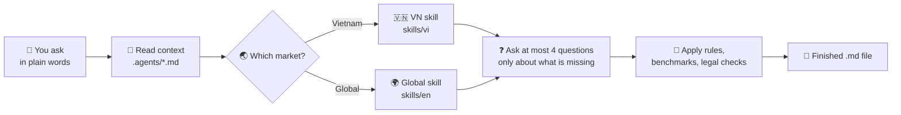

| Building block | What it is | Where it lives |
|---|---|---|
| **Context** | Your business on one page, written once | `.agents/` in your project |
| **Skill** | One marketing job, start to finish | `skills/vi/`, `skills/en/`, `modules/` |
| **Agent** | A role (strategist, content, design…) that picks the right skills | `agents/` |
| **Workflow** | A fixed chain of skills for a multi-day job or a monthly loop | `workflows/`, `modules/*/workflows/` |
| **Knowledge** | Background reading to upload into an AI project per role | `knowledge/` |

**Skills call each other.** One request can pull in several skills, in order:

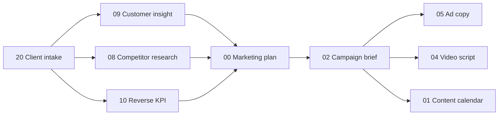

### Pick a skill by what you need

| If you need… | Start with |
|---|---|
| 📈 A plan or a budget | **00** plan · **10** reverse KPI · **61** budget |
| ✍️ Content that sells | **01** calendar · **04** video · **05** ads · **37** captions |
| 🎨 Visuals | **30** design master · **41** asset list · **42** image brief |
| 🔍 Ads that stopped working | **21** ads audit · **03** diagnosis · **53** tracking |
| 🛒 Selling on marketplaces (VN) | **76** Shopee / TikTok Shop · **75** KOC · **77** chatbot |
| 🧲 More leads and repeat buyers (VN) | **70** lead magnet · **68** CRO · **69** retention |
| 🎙️ A personal brand | **22** context · **23** strategy · **24** AI avatar |
| 🧠 An AI marketing system | **34** AI Marketing OS · `knowledge/` |

---

## 🌏 Vietnam or Global

<table>
<tr>
<td width="50%" valign="top">

<h3>🇻🇳 VN cluster · 78 skills</h3>
<ul>
<li>VND budgets and Vietnam benchmarks 2025-2026</li>
<li>Facebook, Zalo OA, TikTok, Shopee, TikTok Shop, Lazada</li>
<li>KOC programmes, livestream selling, sales chatbots</li>
<li>One legal hub for Vietnamese advertising and data rules</li>
</ul>
</td>
<td width="50%" valign="top">

<h3>🌍 Global cluster · 69 skills</h3>
<ul>
<li>Variants for the US, EU, Southeast Asia and Latin America</li>
<li>Local currency, privacy law and top channels per region</li>
<li>FTC, GDPR and CCPA compliance notes</li>
<li>Dropshipping flagship (<code>29-dropshipping-mastery-global</code>)</li>
</ul>
</td>
</tr>
</table>

You never switch modes by hand. The skills and agents look at which context file exists:

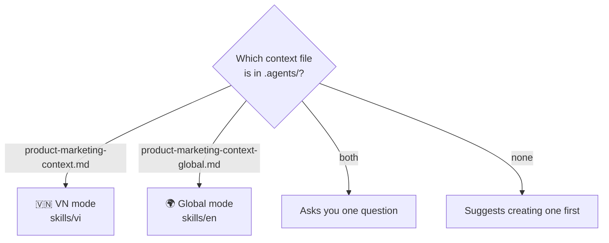

The same rule applies to personal brands (`personal-brand-context.md` / `-global.md`). When both a product and a personal brand context exist, skills `04` (video script) and `05` (ad copy) ask whether to write for sales or for authority.

| Region | Currency | Privacy | Top channels |
|---|---|---|---|
| **US** | USD | CCPA / state laws | Meta, Google, TikTok, YouTube |
| **EU** | EUR / GBP | GDPR | Meta, Google, LinkedIn, TikTok |
| **SEA** | IDR / THB / SGD / PHP | PDPA (varies) | TikTok Shop, Shopee, Lazada, Meta |
| **LATAM** | BRL / MXN / ARS | LGPD (Brazil) | Meta, TikTok, MercadoLibre, WhatsApp |

Skills with a file per region (`variants/01-us.md` … `04-latam.md`): the foundation context, 03, 10, 11, 14, 17, 18 and 21. More in [docs/global-region-guide.md](docs/global-region-guide.md).

---

## 👥 Meet the 6 agents

An agent is a role. Tell it the goal and it picks the right skills, in VN or Global mode.

<table>
<tr>
<td width="33%" valign="top">
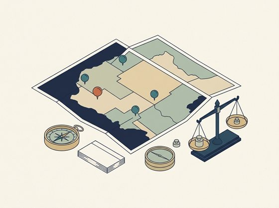
<b><a href="agents/mkt-strategist.md">mkt-strategist</a></b><br/>
Plans, offers, positioning, launches, budgets.<br/>
<sub>00 · 02 · 08 · 09 · 10 · 31-34 · 58-61</sub>
</td>
<td width="33%" valign="top">

<b><a href="agents/content-producer.md">content-producer</a></b><br/>
Calendars, video scripts, ad copy, captions, seeding.<br/>
<sub>01 · 04-06 · 35-40 · 42-44 · 74</sub>
</td>
<td width="33%" valign="top">

<b><a href="agents/design-producer.md">design-producer</a></b><br/>
Visual briefs, brand guideline, design review, resizing.<br/>
<sub>12 · 30 · 41-50</sub>
</td>
</tr>
<tr>
<td width="33%" valign="top">
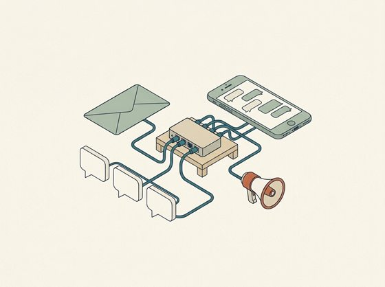
<b><a href="agents/channel-operator.md">channel-operator</a></b><br/>
Channels, landing pages, email, KOC, sales chatbots, crises.<br/>
<sub>11 · 12 · 14 · 15 · 34 · 49 · 66 · 75 · 77</sub>
</td>
<td width="33%" valign="top">
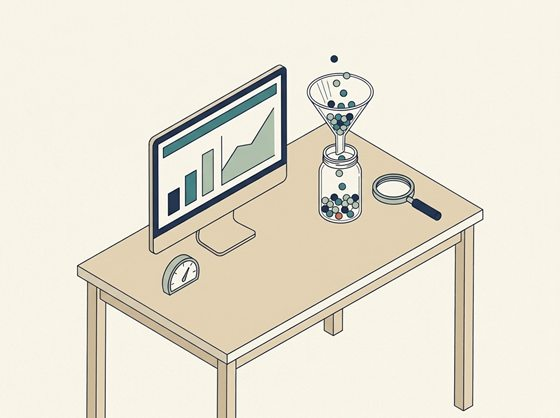
<b><a href="agents/performance-analyst.md">performance-analyst</a></b><br/>
Tracking, ads audits, KPIs, scaling, marketplace ads.<br/>
<sub>03 · 07 · 10 · 13 · 19 · 21 · 32 · 34 · 51-57 · 76</sub>
</td>
<td width="33%" valign="top">

<b><a href="agents/personal-brand-builder.md">personal-brand-builder</a></b><br/>
Founder and creator brands, AI avatar videos, podcasts.<br/>
<sub>22-28</sub>
</td>
</tr>
</table>

How the team passes work along in a typical campaign:

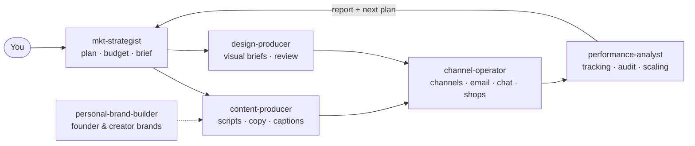

---

## 🔁 Workflows

A workflow is a fixed chain of skills: either a job that takes several days, or a loop you run every month.

**Content engine: a monthly loop**

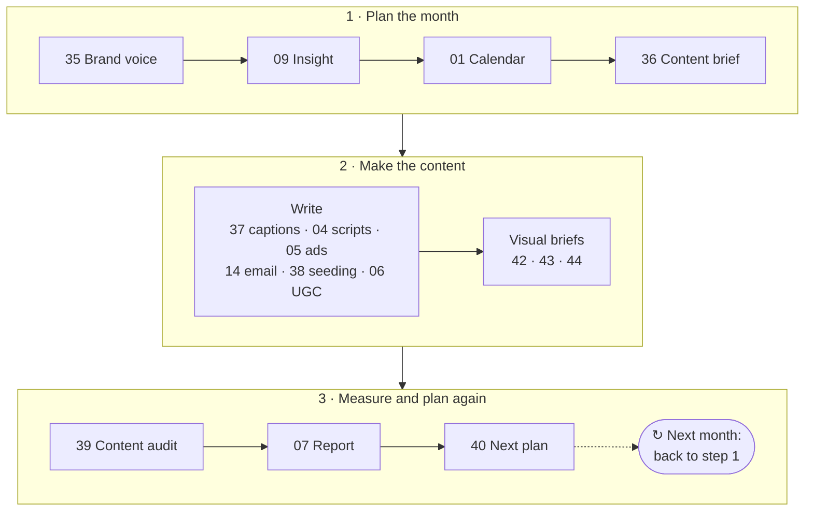

**Performance loop: no spend before tracking works**

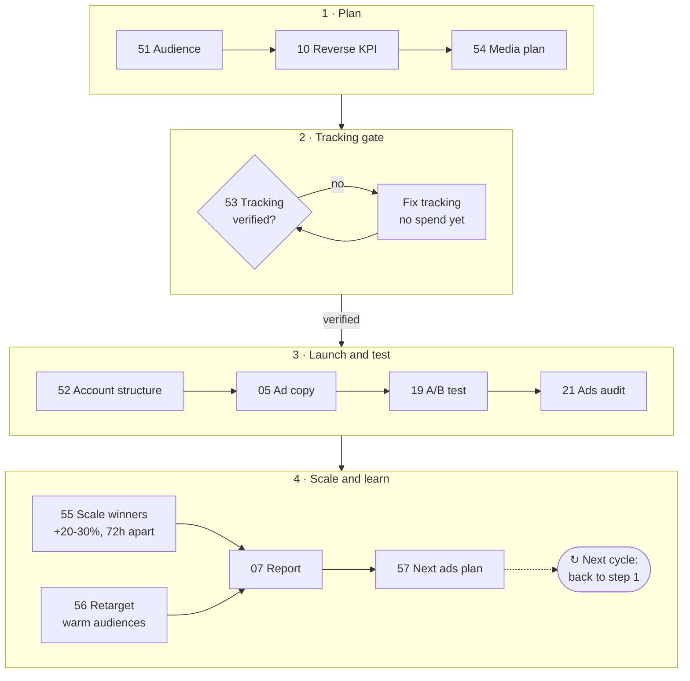

**Design pipeline: counted back from launch day**

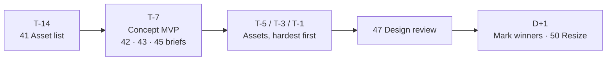

<details>
<summary><b>All 19 workflows</b> (11 VN + 8 Global)</summary>

| Workflow | When | Skill chain |
|---|---|---|
| [`client-onboard`](workflows/vi/client-onboard.md) | New agency client, 5-7 days | 20 → 09 → 08 → 10 → 00 → 02 → 01 |
| [`campaign-launch`](workflows/vi/campaign-launch.md) | Idea to live campaign, 14-21 days | 08 → 09 → 00 → 02 → 01 + 04 + 05 → 06 → 11 + 12 |
| [`monthly-cycle`](workflows/vi/monthly-cycle.md) | Month end, 3-5 days | 13 → 03 → 07 → 10 → 01 |
| [`content-production`](workflows/vi/content-production.md) | Every week | 01 → 04 → shoot and edit → 05 → schedule |
| [`content-engine`](workflows/vi/content-engine.md) | Monthly content loop | 35 → 09 → 01 → 36 → [37, 04, 05, 14, 38, 06] → [42, 43, 44] → 39 → 07 → 40 |
| [`performance-loop`](workflows/vi/performance-loop.md) | Media buying loop | 51 → 10 → 54 → 53 → 52 → 05 → 19 → 21 → 55 / 56 → 07 → 57 |
| [`design-pipeline`](workflows/vi/design-pipeline.md) | T-14 to D+1 | 41 → [42, 43, 45] → 47 → 50 |
| [`leader-cadence`](workflows/vi/leader-cadence.md) | Quarter, campaign, week | 00 → 61 → 02 → 64 → 62 / 47 → 07 → 63 |
| [`personal-brand-launch`](modules/personal-branding/workflows/vi/personal-brand-launch.md) | First 30 days | 22 → 23 → 24 → 25 → 26 → 04 → 27 → 28 → 14 |
| [`ai-avatar-batch`](modules/personal-branding/workflows/vi/ai-avatar-batch.md) | 30 videos in 5 days | 22 → 26 → 04 → 24 → 25 → 01 |
| [`personal-brand-monthly`](modules/personal-branding/workflows/vi/personal-brand-monthly.md) | Month end, 3-5 days | 13 → 03 → 23 → 27 → 26 → 04 → 07 → 28 → 14 |
| [`client-onboard-global`](workflows/en/client-onboard-global.md) | New client, 5-7 days | 20 → 09 → 08 → 10 → 00 → 02 → 01 |
| [`campaign-launch-global`](workflows/en/campaign-launch-global.md) | 14-21 days, multi-region | 08 → 09 → 00 → 02 → 01 + 04 + 05 → 06 → 11 + 12 |
| [`monthly-cycle-global`](workflows/en/monthly-cycle-global.md) | Month end, 3-5 days | 13 → 03 → 07 → 10 → 01 |
| [`content-production-global`](workflows/en/content-production-global.md) | Every week | 01 → 04 → 05 → 06 |
| [`personal-brand-launch-global`](modules/personal-branding/workflows/en/personal-brand-launch-global.md) | First 30 days | 22 → 23 → 24 → 26 → 04 → 25 → 27 → 05 → 28 → 14 |
| [`ai-avatar-batch-global`](modules/personal-branding/workflows/en/ai-avatar-batch-global.md) | 30 videos in 5 days | 22 → 26 → 04 → 24 → 25 → 01 |
| [`personal-brand-monthly-global`](modules/personal-branding/workflows/en/personal-brand-monthly-global.md) | Month end, 3-5 days | 13 → 03 → 23 → 27 → 26 → 04 → 07 → 28 → 14 |
| [`dropshipping-launch-global`](modules/dropshipping/workflows/en/dropshipping-launch-global.md) | New product, 30 days | 29 → 12 → 04 → 05 → 21 → 13 → 17 |

Step-by-step guide: [docs/workflow-guide.md](docs/workflow-guide.md).

</details>

---

## 📦 All 147 skills

| Group | Numbers | 🇻🇳 VN | 🌍 Global |
|---|---|:-:|:-:|
| Foundation context | ★ | 1 | 1 |
| Marketing core | 00-21 | 22 | 22 |
| Personal brand + AI avatar | 22-28 | 7 | 7 |
| Regional flagship | 29 | B2B export | Dropshipping |
| Design master, growth, AI Marketing OS | 30-34 | 5 | 5 |
| Content system | 35-40 | 6 | 6 |
| Design production | 41-50 | 10 | 10 |
| Performance ops | 51-57 | 7 | 7 |
| Leader ops | 58-67 | 10 | 10 |
| Conversion, retention, sales, commerce | 68-77 | 9 | · |
| **Total** | | **78** | **69** |

Click a group to see every skill:

<!-- CATALOG:START -->
<details>
<summary><b>Foundation · ★</b> &nbsp;·&nbsp; 1 VN + 1 Global</summary>

| # | 🇻🇳 VN skill | 🌍 Global skill | What it does |
|---|---|---|---|
| ★ | [`product-marketing-context`](skills/vi/product-marketing-context/) | [`product-marketing-context-global`](skills/en/product-marketing-context-global/) | Your product, customers, competitors and positioning, saved once and read by every skill |

</details>

<details>
<summary><b>Marketing core · 00-21</b> &nbsp;·&nbsp; 22 VN + 22 Global</summary>

| # | 🇻🇳 VN skill | 🌍 Global skill | What it does |
|---|---|---|---|
| 00 | [`00-ke-hoach-mkt`](skills/vi/00-ke-hoach-mkt/) | [`00-marketing-plan-global`](skills/en/00-marketing-plan-global/) | Full marketing plan: 7 sections, KPIs in 3 scenarios, budget, timeline |
| 01 | [`01-lich-noi-dung`](skills/vi/01-lich-noi-dung/) | [`01-content-calendar-global`](skills/en/01-content-calendar-global/) | Monthly content calendar with a 1-to-9 repurposing matrix |
| 02 | [`02-brief-chien-dich`](skills/vi/02-brief-chien-dich/) | [`02-campaign-brief-global`](skills/en/02-campaign-brief-global/) | Campaign brief: 9 sections, RACI, risks |
| 03 | [`03-danh-gia-hieu-suat`](skills/vi/03-danh-gia-hieu-suat/) | [`03-performance-eval-global`](skills/en/03-performance-eval-global/) | Performance diagnosis: decision tree, 5 Whys, 48-hour actions |
| 04 | [`04-script-video`](skills/vi/04-script-video/) | [`04-script-video-global`](skills/en/04-script-video-global/) | Video scripts: A/B versions, 5 hooks, viral score |
| 05 | [`05-copy-quang-cao`](skills/vi/05-copy-quang-cao/) | [`05-ad-copy-global`](skills/en/05-ad-copy-global/) | Ad copy: 6 variations for cold, warm and hot audiences |
| 06 | [`06-brief-ugc-egc`](skills/vi/06-brief-ugc-egc/) | [`06-ugc-egc-brief-global`](skills/en/06-ugc-egc-brief-global/) | UGC / EGC creator brief with legal and payment terms |
| 07 | [`07-bao-cao-marketing`](skills/vi/07-bao-cao-marketing/) | [`07-marketing-report-global`](skills/en/07-marketing-report-global/) | Monthly report you can read in 5 minutes |
| 08 | [`08-nghien-cuu-doi-thu`](skills/vi/08-nghien-cuu-doi-thu/) | [`08-competitor-research-global`](skills/en/08-competitor-research-global/) | Competitor research: 3 tiers, SWOT, positioning map |
| 09 | [`09-insight-khach-hang`](skills/vi/09-insight-khach-hang/) | [`09-customer-insight-global`](skills/en/09-customer-insight-global/) | Customer insight: personas, jobs to be done, journey |
| 10 | [`10-tinh-kpi-nguoc`](skills/vi/10-tinh-kpi-nguoc/) | [`10-reverse-kpi-global`](skills/en/10-reverse-kpi-global/) | Work back from a revenue target to budget and KPIs |
| 11 | [`11-thiet-lap-kenh`](skills/vi/11-thiet-lap-kenh/) | [`11-channel-setup-global`](skills/en/11-channel-setup-global/) | Set up 7 channels with a 30-day plan |
| 12 | [`12-brief-landing-page`](skills/vi/12-brief-landing-page/) | [`12-landing-page-brief-global`](skills/en/12-landing-page-brief-global/) | Landing page brief: 7 sections and an A/B plan |
| 13 | [`13-phan-tich-du-lieu`](skills/vi/13-phan-tich-du-lieu/) | [`13-data-analysis-global`](skills/en/13-data-analysis-global/) | Turn Meta, TikTok and GA4 data into insights and anomalies |
| 14 | [`14-email-marketing`](skills/vi/14-email-marketing/) | [`14-email-marketing-global`](skills/en/14-email-marketing-global/) | Email flows: welcome, nurture, win-back, automation |
| 15 | [`15-social-listening`](skills/vi/15-social-listening/) | [`15-social-listening-global`](skills/en/15-social-listening-global/) | Social listening with a crisis protocol |
| 16 | [`16-marketing-psychology`](skills/vi/16-marketing-psychology/) | [`16-marketing-psychology-global`](skills/en/16-marketing-psychology-global/) | Persuasion psychology, adapted to the culture |
| 17 | [`17-pricing-strategy`](skills/vi/17-pricing-strategy/) | [`17-pricing-strategy-global`](skills/en/17-pricing-strategy-global/) | Pricing: tiers, anchors, bundles, break-even |
| 18 | [`18-referral-program`](skills/vi/18-referral-program/) | [`18-referral-program-global`](skills/en/18-referral-program-global/) | Referral and affiliate programmes with anti-fraud rules |
| 19 | [`19-ab-test-setup`](skills/vi/19-ab-test-setup/) | [`19-ab-test-setup-global`](skills/en/19-ab-test-setup-global/) | A/B test setup: sample size and significance |
| 20 | [`20-brief-client-intake`](skills/vi/20-brief-client-intake/) | [`20-client-intake-brief-global`](skills/en/20-client-intake-brief-global/) | Client intake brief for agencies, 20 industries |
| 21 | [`21-audit-ads-performance`](skills/vi/21-audit-ads-performance/) | [`21-ads-audit-global`](skills/en/21-ads-audit-global/) | Ads audit: health score and a ranked fix list |

</details>

<details>
<summary><b>Personal brand + AI avatar · 22-28</b> &nbsp;·&nbsp; 7 VN + 7 Global</summary>

| # | 🇻🇳 VN skill | 🌍 Global skill | What it does |
|---|---|---|---|
| 22 | [`22-personal-brand-context`](modules/personal-branding/vi/22-personal-brand-context/) | [`22-personal-brand-context-global`](modules/personal-branding/en/22-personal-brand-context-global/) | Personal brand foundation for founders, coaches, creators |
| 23 | [`23-personal-brand-strategy`](modules/personal-branding/vi/23-personal-brand-strategy/) | [`23-personal-brand-strategy-global`](modules/personal-branding/en/23-personal-brand-strategy-global/) | 12-month personal brand strategy and authority ladder |
| 24 | [`24-ai-avatar-production`](modules/personal-branding/vi/24-ai-avatar-production/) | [`24-ai-avatar-production-global`](modules/personal-branding/en/24-ai-avatar-production-global/) | AI avatar video production with QA scoring |
| 25 | [`25-voice-clone-podcast`](modules/personal-branding/vi/25-voice-clone-podcast/) | [`25-voice-clone-podcast-global`](modules/personal-branding/en/25-voice-clone-podcast-global/) | Voice clone, podcast and audiobook |
| 26 | [`26-thought-leadership-content`](modules/personal-branding/vi/26-thought-leadership-content/) | [`26-thought-leadership-content-global`](modules/personal-branding/en/26-thought-leadership-content-global/) | Long-form thought leadership content |
| 27 | [`27-personal-brand-monetize`](modules/personal-branding/vi/27-personal-brand-monetize/) | [`27-personal-brand-monetize-global`](modules/personal-branding/en/27-personal-brand-monetize-global/) | Monetise a personal brand: funnels and pricing |
| 28 | [`28-community-building`](modules/personal-branding/vi/28-community-building/) | [`28-community-building-global`](modules/personal-branding/en/28-community-building-global/) | Community building on Zalo, Telegram, Skool |

</details>

<details>
<summary><b>Regional flagship · 29 (different per market)</b> &nbsp;·&nbsp; 1 VN + 1 Global</summary>

| # | 🇻🇳 VN skill | 🌍 Global skill | What it does |
|---|---|---|---|
| 29 | [`29-xuat-khau-b2b`](skills/vi/29-xuat-khau-b2b/) | [`29-dropshipping-mastery-global`](modules/dropshipping/en/29-dropshipping-mastery-global/) | 🇻🇳 B2B export playbook for Vietnamese SMEs · 🌍 Dropshipping from niche to scale |

</details>

<details>
<summary><b>Design master, growth, AI Marketing OS · 30-34</b> &nbsp;·&nbsp; 5 VN + 5 Global</summary>

| # | 🇻🇳 VN skill | 🌍 Global skill | What it does |
|---|---|---|---|
| 30 | [`30-thiet-ke-master`](skills/vi/30-thiet-ke-master/) | [`30-design-master-global`](skills/en/30-design-master-global/) | Design master: 8 design types, image prompts for your tools |
| 31 | [`31-offer-design`](skills/vi/31-offer-design/) | [`31-offer-design-global`](skills/en/31-offer-design-global/) | Offer design: value stack, guarantee, bonuses, offer ladder |
| 32 | [`32-seo-growth`](skills/vi/32-seo-growth/) | [`32-seo-growth-global`](skills/en/32-seo-growth-global/) | SEO and AI search visibility (GEO), schema, backlinks |
| 33 | [`33-b2b-lead-gen`](skills/vi/33-b2b-lead-gen/) | [`33-b2b-lead-gen-global`](skills/en/33-b2b-lead-gen-global/) | B2B lead generation, outreach, CRM hand-off |
| 34 | [`34-ai-marketing-os`](skills/vi/34-ai-marketing-os/) | [`34-ai-marketing-os-global`](skills/en/34-ai-marketing-os-global/) | AI Marketing OS: Brand Hub, role agents, SOPs, data loops |

</details>

<details>
<summary><b>Content system · 35-40</b> &nbsp;·&nbsp; 6 VN + 6 Global</summary>

| # | 🇻🇳 VN skill | 🌍 Global skill | What it does |
|---|---|---|---|
| 35 | [`35-brand-voice`](skills/vi/35-brand-voice/) | [`35-brand-voice-global`](skills/en/35-brand-voice-global/) | Brand voice document that every content skill reads first |
| 36 | [`36-content-brief`](skills/vi/36-content-brief/) | [`36-content-brief-global`](skills/en/36-content-brief-global/) | Brief for each piece of content |
| 37 | [`37-caption-social`](skills/vi/37-caption-social/) | [`37-social-caption-global`](skills/en/37-social-caption-global/) | Organic social captions |
| 38 | [`38-seeding-plan`](skills/vi/38-seeding-plan/) | [`38-community-seeding-global`](skills/en/38-community-seeding-global/) | Community seeding plan |
| 39 | [`39-content-audit`](skills/vi/39-content-audit/) | [`39-content-audit-global`](skills/en/39-content-audit-global/) | Month-end content audit |
| 40 | [`40-next-content-plan`](skills/vi/40-next-content-plan/) | [`40-next-content-plan-global`](skills/en/40-next-content-plan-global/) | Next content plan, built from the data |

</details>

<details>
<summary><b>Design production · 41-50</b> &nbsp;·&nbsp; 10 VN + 10 Global</summary>

| # | 🇻🇳 VN skill | 🌍 Global skill | What it does |
|---|---|---|---|
| 41 | [`41-campaign-asset-list`](skills/vi/41-campaign-asset-list/) | [`41-campaign-asset-list-global`](skills/en/41-campaign-asset-list-global/) | Asset list for a campaign |
| 42 | [`42-brief-hinh-anh`](skills/vi/42-brief-hinh-anh/) | [`42-image-brief-global`](skills/en/42-image-brief-global/) | Image brief |
| 43 | [`43-brief-carousel`](skills/vi/43-brief-carousel/) | [`43-carousel-brief-global`](skills/en/43-carousel-brief-global/) | Carousel brief |
| 44 | [`44-brief-video-editor`](skills/vi/44-brief-video-editor/) | [`44-video-editor-brief-global`](skills/en/44-video-editor-brief-global/) | Video editor brief |
| 45 | [`45-brief-canva`](skills/vi/45-brief-canva/) | [`45-design-tool-brief-global`](skills/en/45-design-tool-brief-global/) | Brief for Canva or another design tool |
| 46 | [`46-brand-guideline`](skills/vi/46-brand-guideline/) | [`46-brand-guideline-global`](skills/en/46-brand-guideline-global/) | Brand guideline |
| 47 | [`47-design-review`](skills/vi/47-design-review/) | [`47-design-review-global`](skills/en/47-design-review-global/) | Design review with a score |
| 48 | [`48-quick-visual-brief`](skills/vi/48-quick-visual-brief/) | [`48-quick-visual-brief-global`](skills/en/48-quick-visual-brief-global/) | Quick visual brief while a campaign is live |
| 49 | [`49-html-email-template`](skills/vi/49-html-email-template/) | [`49-html-email-template-global`](skills/en/49-html-email-template-global/) | HTML email template |
| 50 | [`50-asset-resize`](skills/vi/50-asset-resize/) | [`50-asset-resize-global`](skills/en/50-asset-resize-global/) | Resize winning assets for every placement |

</details>

<details>
<summary><b>Performance ops · 51-57</b> &nbsp;·&nbsp; 7 VN + 7 Global</summary>

| # | 🇻🇳 VN skill | 🌍 Global skill | What it does |
|---|---|---|---|
| 51 | [`51-audience-research`](skills/vi/51-audience-research/) | [`51-audience-research-global`](skills/en/51-audience-research-global/) | Audience research |
| 52 | [`52-account-structure`](skills/vi/52-account-structure/) | [`52-account-structure-global`](skills/en/52-account-structure-global/) | Ad account structure and naming |
| 53 | [`53-tracking-setup`](skills/vi/53-tracking-setup/) | [`53-tracking-setup-global`](skills/en/53-tracking-setup-global/) | Tracking, verified before any spend |
| 54 | [`54-media-plan`](skills/vi/54-media-plan/) | [`54-media-plan-global`](skills/en/54-media-plan-global/) | Media plan worked back from revenue |
| 55 | [`55-scaling-ads`](skills/vi/55-scaling-ads/) | [`55-scaling-ads-global`](skills/en/55-scaling-ads-global/) | Scale winners +20-30% per step, at least 72h apart |
| 56 | [`56-retargeting-plan`](skills/vi/56-retargeting-plan/) | [`56-retargeting-plan-global`](skills/en/56-retargeting-plan-global/) | Retargeting plan by audience layer |
| 57 | [`57-next-ads-plan`](skills/vi/57-next-ads-plan/) | [`57-next-ads-plan-global`](skills/en/57-next-ads-plan-global/) | Next ads plan |

</details>

<details>
<summary><b>Leader ops · 58-67</b> &nbsp;·&nbsp; 10 VN + 10 Global</summary>

| # | 🇻🇳 VN skill | 🌍 Global skill | What it does |
|---|---|---|---|
| 58 | [`58-positioning`](skills/vi/58-positioning/) | [`58-positioning-global`](skills/en/58-positioning-global/) | Positioning |
| 59 | [`59-go-to-market`](skills/vi/59-go-to-market/) | [`59-go-to-market-global`](skills/en/59-go-to-market-global/) | Go-to-market plan |
| 60 | [`60-launch-playbook`](skills/vi/60-launch-playbook/) | [`60-launch-playbook-global`](skills/en/60-launch-playbook-global/) | Launch playbook |
| 61 | [`61-budget-planning`](skills/vi/61-budget-planning/) | [`61-budget-planning-global`](skills/en/61-budget-planning-global/) | Budget planning |
| 62 | [`62-marketing-review`](skills/vi/62-marketing-review/) | [`62-marketing-review-global`](skills/en/62-marketing-review-global/) | Review gate for marketing output |
| 63 | [`63-campaign-retrospective`](skills/vi/63-campaign-retrospective/) | [`63-campaign-retrospective-global`](skills/en/63-campaign-retrospective-global/) | Campaign retrospective |
| 64 | [`64-team-brief`](skills/vi/64-team-brief/) | [`64-team-brief-global`](skills/en/64-team-brief-global/) | Team brief |
| 65 | [`65-team-performance-review`](skills/vi/65-team-performance-review/) | [`65-team-performance-review-global`](skills/en/65-team-performance-review-global/) | Team performance review |
| 66 | [`66-crisis-playbook`](skills/vi/66-crisis-playbook/) | [`66-crisis-playbook-global`](skills/en/66-crisis-playbook-global/) | Crisis playbook |
| 67 | [`67-agency-vendor-brief`](skills/vi/67-agency-vendor-brief/) | [`67-agency-vendor-brief-global`](skills/en/67-agency-vendor-brief-global/) | Agency and vendor brief |

</details>

<details>
<summary><b>Conversion, retention, sales, commerce · 68-77</b> &nbsp;·&nbsp; 9 VN</summary>

| # | 🇻🇳 VN skill | 🌍 Global skill | What it does |
|---|---|---|---|
| 68 | [`68-cro-audit-trang`](skills/vi/68-cro-audit-trang/) | · | Conversion audit for a live page, inbox flow or marketplace listing *(VN only)* |
| 69 | [`69-giu-chan-khach-hang`](skills/vi/69-giu-chan-khach-hang/) | · | Customer retention and win-back *(VN only)* |
| 70 | [`70-lead-magnet`](skills/vi/70-lead-magnet/) | · | Lead magnet design *(VN only)* |
| 71 | [`71-sales-enablement`](skills/vi/71-sales-enablement/) | · | Sales collateral and pipeline hand-off *(VN only)* |
| 72 | [`72-hoi-dong-marketing`](skills/vi/72-hoi-dong-marketing/) | · | Advisory board of 5 archetypes with a mandatory dissenter *(VN only)* |
| 74 | [`74-copy-hai-lop`](skills/vi/74-copy-hai-lop/) | · | Two-layer slogans and poster headlines *(VN only)* |
| 75 | [`75-hop-tac-koc-affiliate`](skills/vi/75-hop-tac-koc-affiliate/) | · | KOC and affiliate programmes: vet, contract, pay *(VN only)* |
| 76 | [`76-van-hanh-san-tmdt`](skills/vi/76-van-hanh-san-tmdt/) | · | Run a Shopee, TikTok Shop or Lazada store on order-level P&L *(VN only)* |
| 77 | [`77-kich-ban-sale-chatbot`](skills/vi/77-kich-ban-sale-chatbot/) | · | Sales scripts for an AI chatbot (inbox and public comments) *(VN only)* |

</details>
<!-- CATALOG:END -->

---

## 🛡️ Built-in guardrails

Every skill follows the same 8 operating rules ([VN](skills/vi/references/quy-tac-van-hanh.md) · [Global](skills/en/references/operating-rules-global.md)): read the context first, treat outside content as data rather than instructions, label evidence, date and source every number, never invent numbers or customers, and send every real-world action through a draft-first gate.

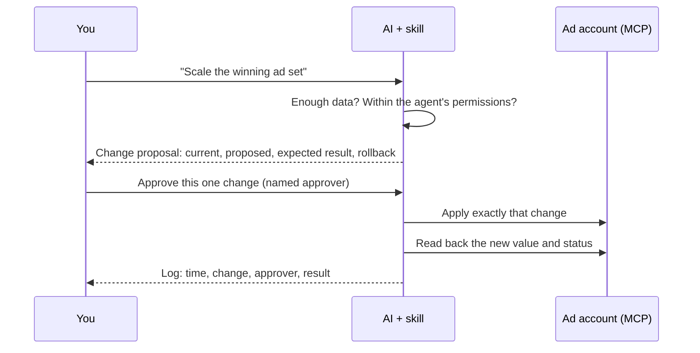

- **Ads decisions follow one ladder.** Below 3x the target CPA in spend there is not enough data to judge. A pause is only proposed, never done silently. Budgets scale +20-30% per step, at least 72 hours apart.
- **Vietnamese legal questions** go to one hub: [`phap-ly-marketing-vn.md`](skills/vi/references/phap-ly-marketing-vn.md).
- **Evals:** skills that changed behaviour ship `evals/evals.json` (trigger, routing, guardrail, context). See [docs/evals.md](docs/evals.md).
- **Ad platform connectors (MCP):** skills 03, 07, 08, 10, 13, 21, 39 and 51-57 can read live ads data. Setup: [docs/mcp-setup-guide.md](docs/mcp-setup-guide.md).

---

## 🔌 Use it with any AI tool

Skills are plain Markdown with a short header, so any assistant that can read a file can use them.

| Tool | How to use it |
|---|---|
| **Claude Code** | Plugin, or `install.sh --global` / `--project` |
| **Claude.ai Projects** | Upload the skills you need, plus `knowledge/`, as project knowledge |
| **ChatGPT** | Put a skill into a Custom GPT's instructions or knowledge files |
| **Gemini** | Paste a skill into a Gem or the system prompt |
| **Cursor, Windsurf** | Add the skills you use to the project rules |
| **GitHub Copilot** | Reference skills from `.github/copilot-instructions.md` |
| **Cline** | List skill paths and trigger words in `.clinerules` |
| **Aider** | `aider --read path/to/SKILL.md` |
| **Codex CLI, OpenCode and other agents** | Point the agent at the installed `SKILL.md` folders, or reference them from `AGENTS.md` |
| **Any chat** | Paste a `SKILL.md`, then: "Follow this workflow. My input: …" |

<details>
<summary><b>Example: <code>.clinerules</code> for Cline</b></summary>

```markdown
# Load ai-business-skills for marketing tasks
Skills live in:
- ~/.claude/skills/marketing/vi/   (Vietnam)
- ~/.claude/skills/marketing/en/   (Global)

Trigger words:
- "marketing plan" / "lập kế hoạch marketing" -> 00-marketing-plan-global / 00-ke-hoach-mkt
- "ad copy" / "viết copy" -> 05-ad-copy-global / 05-copy-quang-cao
- "design image" / "thiết kế ảnh" -> 30-design-master-global / 30-thiet-ke-master

Always read product-marketing-context first.
```

</details>

<details>
<summary><b>Manual use in any chat, step by step</b></summary>

1. Paste `skills/en/product-marketing-context-global/SKILL.md` (or the VN one) and answer its questions. Keep the answer.
2. Open the skill you need, for example `skills/en/00-marketing-plan-global/SKILL.md`.
3. Paste it with the saved context and write: "Follow this workflow. My input: …"
4. The AI follows the skill's questions, rules and output template.

</details>

---

## 🧱 Anatomy of a skill

<details>
<summary><b>What is inside a <code>SKILL.md</code></b></summary>

```markdown
---
name: 00-ke-hoach-mkt
description: Short description the AI uses to decide when to run the skill
category: strategy
triggers:
  - "lập kế hoạch marketing"
  - "marketing plan"
output: .md file with 7 sections + KPIs in 3 scenarios
related: [08-nghien-cuu-doi-thu, 09-insight-khach-hang, 10-tinh-kpi-nguoc]
---

# Skill title

## Gather information   -> at most 4 questions, skipped when the context answers them
## Rules                -> insight before numbers, local benchmarks, no generic advice
## Output structure     -> the exact sections, tables and scenarios to deliver
## Quality checklist    -> checked before the file is handed over
```

</details>

---

## 📊 Vietnam benchmarks 2025-2026 (quick reference)

| Metric | Poor | Average | Good | Excellent |
|---|---|---|---|---|
| **Meta cost per message** | >40K | 25-40K | 18-25K | <18K |
| **TikTok cost per message** | >45K | 28-45K | 20-28K | <20K |
| **Lead → booking** | <40% | 40-60% | 60-75% | >75% |
| **Booking → customer** | <25% | 25-40% | 40-55% | >55% |
| **ROAS** | <2x | 2-4x | 4-7x | >7x |
| **Email open rate** | <15% | 15-25% | 25-35% | >35% |
| **Zalo OA read rate** | <40% | 40-60% | 60-80% | >80% |

Costs in VND. By industry: [`references/benchmarks-vietnam.md`](references/benchmarks-vietnam.md) · Global: [`references/benchmarks-global.md`](references/benchmarks-global.md)

---

## 📚 Guides

| Guide | For |
|---|---|
| [Getting started (VN)](docs/getting-started.md) · [Global](docs/getting-started-global.md) | Your first hour |
| [Personal brand](docs/getting-started-personal-brand.md) | Founders, coaches, creators |
| [Role SOP packs](docs/getting-started-role-sop.md) | Content, design, performance and leader teams |
| [Workflow guide](docs/workflow-guide.md) · [Skill map](docs/skill-map.md) | Chaining skills |
| [Global regions](docs/global-region-guide.md) · [Dropshipping](docs/dropshipping-guide.md) | Selling outside Vietnam |
| [MCP setup](docs/mcp-setup-guide.md) · [Connectors](CONNECTORS.md) | Live data from ad platforms |
| [Knowledge base](knowledge/README.md) | Background reading per role |
| [FAQ](docs/faq.md) · [Best practices](docs/best-practices.md) · [Updating](docs/update-guide.md) | Everything else |

<details>
<summary><b>Repository layout</b></summary>

```text
ai-business-skills/
├── skills/
│   ├── vi/            VN skills: foundation, 00-21, 29-72, 74-77, references/
│   └── en/            Global skills: foundation, 00-21, 30-67, references/
├── modules/
│   ├── personal-branding/   22-28 in vi/ and en/, plus 6 workflows
│   └── dropshipping/        29-dropshipping-mastery-global, plus 1 workflow
├── agents/            6 role agents
├── workflows/         vi/ (8) and en/ (4)
├── knowledge/         10 foundation files + trien-khai/ (14 role playbooks)
├── references/        shared benchmarks, KPI formulas, templates
├── examples/          sample outputs: spa, fashion, coach, dropshipping store
├── docs/              guides, FAQ, evals, images
├── scripts/           check-repo.mjs (repo consistency check)
├── install.sh · install.ps1
└── validate-skills.sh · validate-skills.ps1
```

</details>

---

## 🤝 Contributing

Read [`CONTRIBUTING.md`](CONTRIBUTING.md) first.

```bash
git checkout -b feature/new-skill
./validate-skills.sh             # frontmatter and structure
node scripts/check-repo.mjs      # evals, denylist, llms.txt, manifest, versions, counts
git commit -m "feat(skill): add new-skill"
```

Bilingual VN + EN is preferred, one language is accepted. Register a new skill in `.claude-plugin/marketplace.json`.

## 💖 Support

Free and MIT-licensed. If it saves you hours, you can support new region variants, industry skills and bilingual tutorials at [**opa.business/donate**](https://www.opa.business/donate). Starring the repo, [reporting bugs](https://github.com/minhnv0807/ai-business-skills/issues) and sending PRs help too.

<a href="https://star-history.com/#minhnv0807/ai-business-skills&Date">
 <picture>
   <source media="(prefers-color-scheme: dark)" srcset="https://api.star-history.com/svg?repos=minhnv0807/ai-business-skills&type=Date&theme=dark" />
   <source media="(prefers-color-scheme: light)" srcset="https://api.star-history.com/svg?repos=minhnv0807/ai-business-skills&type=Date" />
   
 </picture>
</a>

## 📜 License and credits

MIT, see [LICENSE](LICENSE). Third-party ideas and their licences: [NOTICE.md](NOTICE.md).
Inspired by [coreyhaines31/marketingskills](https://github.com/coreyhaines31/marketingskills) (foundation skill and plugin layout). Follows the [Agent Skills spec](https://agentskills.io).
The illustrations are AI-generated (Google image model via Antigravity); prompts and notes are in [docs/images/README.md](docs/images/README.md).

<p align="center">
  <sub>Framework by <a href="https://opa.business">Over Powers Agency</a> · Built with AI, for marketers who use AI.</sub>
</p>
