<p align="center">
  
</p>

<h1 align="center">ai-business-skills</h1>

<p align="center">
  <b>147 skill marketing biến trợ lý AI của bạn thành cả một đội marketing.</b><br/>
  Làm cho thị trường Việt Nam trước, dùng được cho Mỹ, châu Âu, Đông Nam Á và Mỹ Latin.
</p>

<p align="center">
  <a href="README.md"></a>
  <a href="README.vi.md"></a>
</p>

<p align="center">
  
  
  
  
  
  
  <a href="https://github.com/minhnv0807/ai-business-skills/stargazers"></a>
  <a href="https://github.com/minhnv0807/ai-business-skills/commits/master"></a>
  <a href="https://www.opa.business/donate"></a>
</p>

<p align="center">
  <a href="#-bắt-đầu-nhanh">Bắt đầu nhanh</a> ·
  <a href="#-cách-hoạt-động">Cách hoạt động</a> ·
  <a href="#-việt-nam-hay-global">Việt Nam hay Global</a> ·
  <a href="#-6-agent-trong-đội">Agent</a> ·
  <a href="#-workflow">Workflow</a> ·
  <a href="#-toàn-bộ-147-skill">Toàn bộ skill</a> ·
  <a href="#-dùng-với-ai-tool-khác">AI tool khác</a>
</p>

---

## ✨ Bạn nhận được gì

Mỗi skill là một file Markdown (`SKILL.md`) dạy trợ lý AI làm trọn một việc marketing: cần hỏi bạn những gì, áp dụng quy tắc và benchmark nào, và tài liệu cuối cùng phải có những phần nào. Bạn hỏi bằng lời thường. Bạn nhận về một file `.md` hoàn chỉnh, không phải lời khuyên chung chung.

<p align="center">
  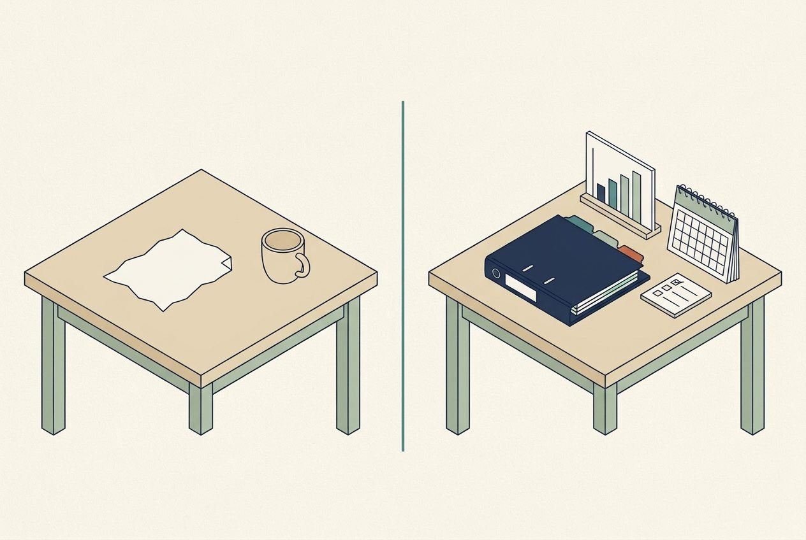
</p>

| Bạn hỏi | AI thông thường trả lời | Với ai-business-skills |
|---|---|---|
| "Lập kế hoạch marketing cho spa của tôi" | 500 chữ lời khuyên chung | Kế hoạch đầy đủ: 7 phần, KPI theo 3 kịch bản, phân bổ ngân sách, timeline theo tuần, bảng rủi ro |
| "Viết quảng cáo Facebook cho liệu trình facial mới" | Một đoạn văn chung chung | 6 phiên bản (2 cho tệp lạnh, 2 tệp ấm, 2 tệp nóng), mỗi bản có headline, primary text và CTA |
| "Viết báo cáo tháng này" | Một danh sách số liệu | Insight trước, rồi nguyên nhân gốc, việc cần làm trong 48 giờ tới và kế hoạch tháng sau |

**Hợp với:** kế hoạch marketing, brief chiến dịch, copy quảng cáo và kịch bản video, lịch nội dung, audit ads, bán hàng trên Shopee / TikTok Shop / Lazada, thương hiệu cá nhân, và vận hành đội marketing bằng AI.
**Không dành cho:** viết code sản phẩm, đặc tả kỹ thuật hay deploy server.

---

## ⚡ Bắt đầu nhanh

### 1. Cài đặt (chọn một cách)

**Plugin Claude Code (dễ nhất, cài đủ 147 skill)**

```text
/plugin marketplace add minhnv0807/ai-business-skills
/plugin install ai-business-skills
```

**Script cài đặt**

```bash
git clone https://github.com/minhnv0807/ai-business-skills.git
cd ai-business-skills
bash install.sh --global      # macOS / Linux -> ~/.claude/skills/marketing/
```

```powershell
.\install.ps1 -Global          # Windows
```

> Script chép `skills/`, `agents/`, `workflows/`, `knowledge/` và `references/`. Các skill thương hiệu cá nhân và dropshipping nằm trong `modules/`: có sẵn khi cài bằng plugin, hoặc bạn tự chép thư mục đó.

**AI tool khác (ChatGPT, Gemini, Cursor…):** xem [Dùng với AI tool khác](#-dùng-với-ai-tool-khác).

### 2. Mô tả doanh nghiệp một lần

```text
> Thiết lập product marketing context cho Luna Spa
```

AI phỏng vấn bạn rồi lưu `.agents/product-marketing-context.md`: sản phẩm, khách hàng, đối thủ, định vị, bằng chứng và các lời từ chối thường gặp. Skill nào cũng đọc file này trước, nên bạn không phải kể lại từ đầu. Nếu bán ra ngoài Việt Nam, AI lưu `product-marketing-context-global.md`.

### 3. Giao việc thật

```text
> Lập kế hoạch marketing tháng sau cho Luna Spa
> Viết kịch bản TikTok 30 giây cho liệu trình facial mới
> CPMess đang 45K, ROAS 1.8x. Audit giúp tôi và chỉ ra cần sửa gì
> Tính ngược: cần ngân sách bao nhiêu để đạt doanh thu 200 triệu/tháng?
```

Mỗi câu trả lời được lưu thành `[skill]-[sản-phẩm]-[YYYYMMDD].md`, ví dụ `ke-hoach-mkt-spa-luna-20260415.md`.

---

## 🧭 Cách hoạt động

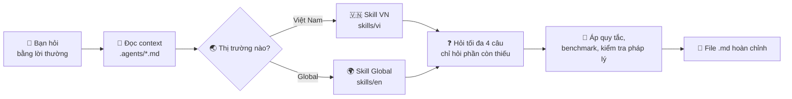

| Thành phần | Là gì | Nằm ở đâu |
|---|---|---|
| **Context** | Doanh nghiệp của bạn trên một trang, viết một lần | `.agents/` trong dự án của bạn |
| **Skill** | Một việc marketing, làm từ đầu đến cuối | `skills/vi/`, `skills/en/`, `modules/` |
| **Agent** | Một vai trò (chiến lược, nội dung, thiết kế…) tự chọn skill phù hợp | `agents/` |
| **Workflow** | Chuỗi skill cố định cho việc kéo dài nhiều ngày hoặc vòng lặp hằng tháng | `workflows/`, `modules/*/workflows/` |
| **Knowledge** | Tài liệu nền để nạp vào AI project theo từng vai trò | `knowledge/` |

**Skill gọi lẫn nhau.** Một yêu cầu có thể kéo theo nhiều skill, theo đúng thứ tự:

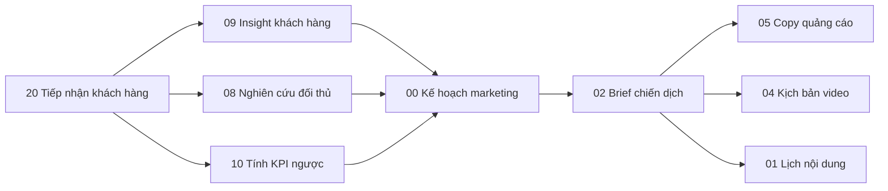

### Chọn skill theo nhu cầu

| Bạn cần… | Bắt đầu với |
|---|---|
| 📈 Kế hoạch hoặc ngân sách | **00** kế hoạch · **10** KPI ngược · **61** ngân sách |
| ✍️ Nội dung bán được hàng | **01** lịch · **04** video · **05** quảng cáo · **37** caption |
| 🎨 Hình ảnh | **30** thiết kế master · **41** danh sách asset · **42** brief hình ảnh |
| 🔍 Quảng cáo hết hiệu quả | **21** audit ads · **03** đánh giá · **53** tracking |
| 🛒 Bán trên sàn TMĐT | **76** Shopee / TikTok Shop · **75** KOC · **77** chatbot |
| 🧲 Thêm lead và khách quay lại | **70** lead magnet · **68** CRO · **69** retention |
| 🎙️ Thương hiệu cá nhân | **22** context · **23** chiến lược · **24** AI avatar |
| 🧠 Hệ thống marketing bằng AI | **34** AI Marketing OS · `knowledge/` |

---

## 🌏 Việt Nam hay Global

<table>
<tr>
<td width="50%" valign="top">

<h3>🇻🇳 Cụm VN · 78 skill</h3>
<ul>
<li>Ngân sách tính bằng VND, benchmark Việt Nam 2025-2026</li>
<li>Facebook, Zalo OA, TikTok, Shopee, TikTok Shop, Lazada</li>
<li>Chương trình KOC, livestream bán hàng, chatbot bán hàng</li>
<li>Một hub pháp lý chung cho quy định quảng cáo và dữ liệu tại Việt Nam</li>
</ul>
</td>
<td width="50%" valign="top">

<h3>🌍 Cụm Global · 69 skill</h3>
<ul>
<li>Biến thể cho Mỹ, châu Âu, Đông Nam Á và Mỹ Latin</li>
<li>Tiền tệ, luật dữ liệu và kênh chính theo từng khu vực</li>
<li>Ghi chú tuân thủ FTC, GDPR và CCPA</li>
<li>Skill chủ lực dropshipping (<code>29-dropshipping-mastery-global</code>)</li>
</ul>
</td>
</tr>
</table>

Bạn không cần tự chuyển chế độ. Skill và agent nhìn xem file context nào đang có:

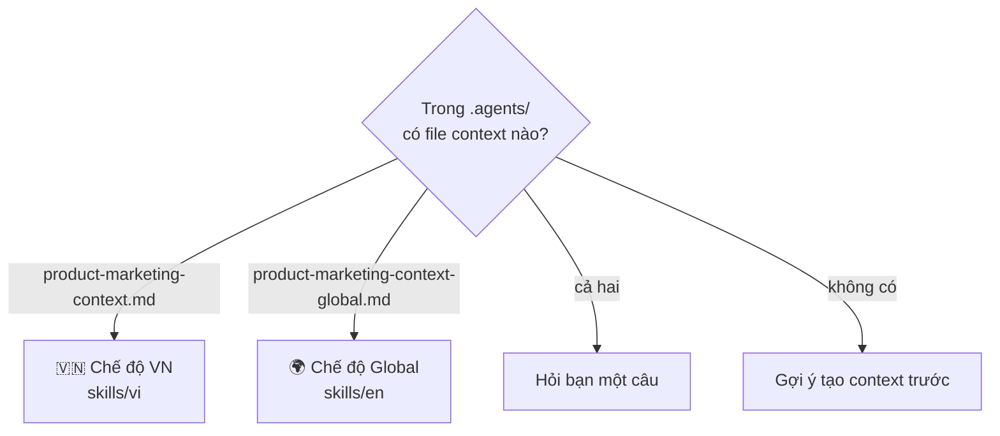

Thương hiệu cá nhân dùng cùng quy tắc (`personal-brand-context.md` / `-global.md`). Khi có cả context sản phẩm lẫn context thương hiệu cá nhân, skill `04` (kịch bản video) và `05` (copy quảng cáo) sẽ hỏi bạn muốn viết để bán hàng hay để xây uy tín.

| Khu vực | Tiền tệ | Luật dữ liệu | Kênh chính |
|---|---|---|---|
| **Mỹ** | USD | CCPA / luật từng bang | Meta, Google, TikTok, YouTube |
| **Châu Âu** | EUR / GBP | GDPR | Meta, Google, LinkedIn, TikTok |
| **Đông Nam Á** | IDR / THB / SGD / PHP | PDPA (khác nhau theo nước) | TikTok Shop, Shopee, Lazada, Meta |
| **Mỹ Latin** | BRL / MXN / ARS | LGPD (Brazil) | Meta, TikTok, MercadoLibre, WhatsApp |

Các skill có file riêng cho từng khu vực (`variants/01-us.md` … `04-latam.md`): foundation context, 03, 10, 11, 14, 17, 18 và 21. Xem thêm [docs/global-region-guide.md](docs/global-region-guide.md).

---

## 👥 6 agent trong đội

Agent là một vai trò. Bạn nói mục tiêu, agent tự chọn skill phù hợp, ở chế độ VN hoặc Global.

<table>
<tr>
<td width="33%" valign="top">
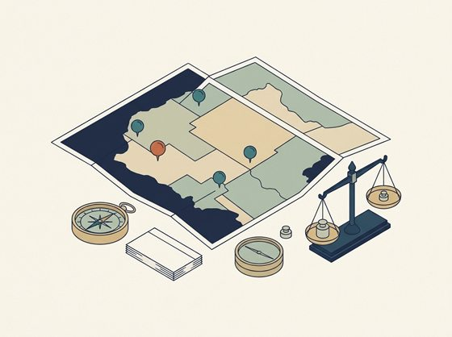
<b><a href="agents/mkt-strategist.md">mkt-strategist</a></b><br/>
Kế hoạch, offer, định vị, ra mắt sản phẩm, ngân sách.<br/>
<sub>00 · 02 · 08 · 09 · 10 · 31-34 · 58-61</sub>
</td>
<td width="33%" valign="top">

<b><a href="agents/content-producer.md">content-producer</a></b><br/>
Lịch nội dung, kịch bản video, copy quảng cáo, caption, seeding.<br/>
<sub>01 · 04-06 · 35-40 · 42-44 · 74</sub>
</td>
<td width="33%" valign="top">

<b><a href="agents/design-producer.md">design-producer</a></b><br/>
Brief hình ảnh, brand guideline, duyệt thiết kế, resize asset.<br/>
<sub>12 · 30 · 41-50</sub>
</td>
</tr>
<tr>
<td width="33%" valign="top">
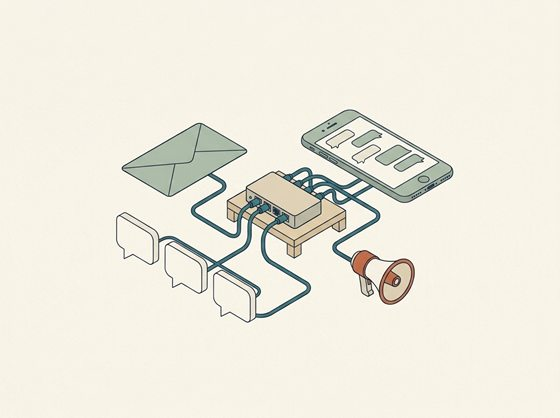
<b><a href="agents/channel-operator.md">channel-operator</a></b><br/>
Kênh, landing page, email, KOC, chatbot bán hàng, xử lý khủng hoảng.<br/>
<sub>11 · 12 · 14 · 15 · 34 · 49 · 66 · 75 · 77</sub>
</td>
<td width="33%" valign="top">
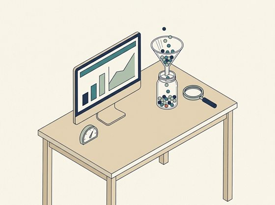
<b><a href="agents/performance-analyst.md">performance-analyst</a></b><br/>
Tracking, audit ads, KPI, scale ngân sách, ads trên sàn TMĐT.<br/>
<sub>03 · 07 · 10 · 13 · 19 · 21 · 32 · 34 · 51-57 · 76</sub>
</td>
<td width="33%" valign="top">

<b><a href="agents/personal-brand-builder.md">personal-brand-builder</a></b><br/>
Thương hiệu founder và creator, video AI avatar, podcast.<br/>
<sub>22-28</sub>
</td>
</tr>
</table>

Cách các agent chuyền việc cho nhau trong một chiến dịch điển hình:

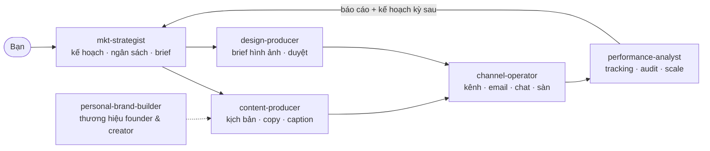

---

## 🔁 Workflow

Workflow là một chuỗi skill cố định: hoặc một việc kéo dài nhiều ngày, hoặc một vòng lặp bạn chạy mỗi tháng.

**Content engine: vòng lặp hằng tháng**

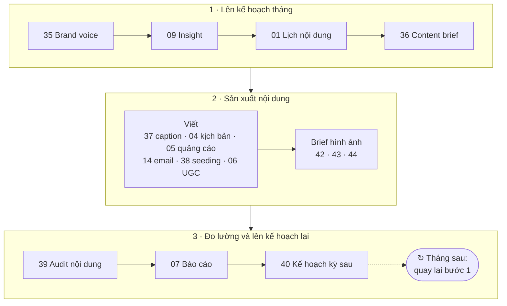

**Performance loop: chưa verify tracking thì chưa tiêu tiền**

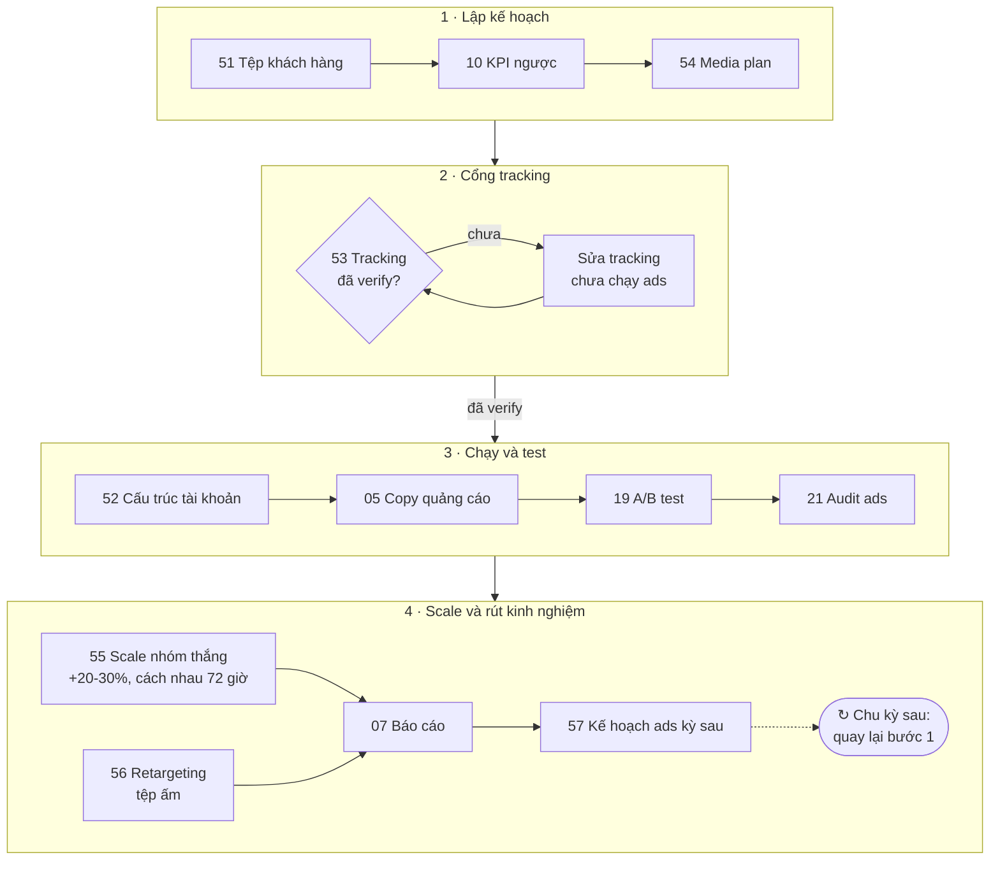

**Design pipeline: đếm ngược từ ngày ra mắt**

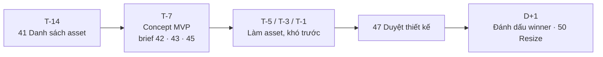

<details>
<summary><b>Toàn bộ 19 workflow</b> (11 VN + 8 Global)</summary>

| Workflow | Khi nào | Chuỗi skill |
|---|---|---|
| [`client-onboard`](workflows/vi/client-onboard.md) | Agency nhận khách mới, 5-7 ngày | 20 → 09 → 08 → 10 → 00 → 02 → 01 |
| [`campaign-launch`](workflows/vi/campaign-launch.md) | Từ ý tưởng đến chiến dịch chạy, 14-21 ngày | 08 → 09 → 00 → 02 → 01 + 04 + 05 → 06 → 11 + 12 |
| [`monthly-cycle`](workflows/vi/monthly-cycle.md) | Cuối tháng, 3-5 ngày | 13 → 03 → 07 → 10 → 01 |
| [`content-production`](workflows/vi/content-production.md) | Hằng tuần | 01 → 04 → quay và dựng → 05 → lên lịch |
| [`content-engine`](workflows/vi/content-engine.md) | Vòng lặp nội dung hằng tháng | 35 → 09 → 01 → 36 → [37, 04, 05, 14, 38, 06] → [42, 43, 44] → 39 → 07 → 40 |
| [`performance-loop`](workflows/vi/performance-loop.md) | Vòng lặp chạy ads | 51 → 10 → 54 → 53 → 52 → 05 → 19 → 21 → 55 / 56 → 07 → 57 |
| [`design-pipeline`](workflows/vi/design-pipeline.md) | Từ T-14 đến D+1 | 41 → [42, 43, 45] → 47 → 50 |
| [`leader-cadence`](workflows/vi/leader-cadence.md) | Theo quý, chiến dịch, tuần | 00 → 61 → 02 → 64 → 62 / 47 → 07 → 63 |
| [`personal-brand-launch`](modules/personal-branding/workflows/vi/personal-brand-launch.md) | 30 ngày đầu | 22 → 23 → 24 → 25 → 26 → 04 → 27 → 28 → 14 |
| [`ai-avatar-batch`](modules/personal-branding/workflows/vi/ai-avatar-batch.md) | 30 video trong 5 ngày | 22 → 26 → 04 → 24 → 25 → 01 |
| [`personal-brand-monthly`](modules/personal-branding/workflows/vi/personal-brand-monthly.md) | Cuối tháng, 3-5 ngày | 13 → 03 → 23 → 27 → 26 → 04 → 07 → 28 → 14 |
| [`client-onboard-global`](workflows/en/client-onboard-global.md) | Khách mới, 5-7 ngày | 20 → 09 → 08 → 10 → 00 → 02 → 01 |
| [`campaign-launch-global`](workflows/en/campaign-launch-global.md) | 14-21 ngày, nhiều khu vực | 08 → 09 → 00 → 02 → 01 + 04 + 05 → 06 → 11 + 12 |
| [`monthly-cycle-global`](workflows/en/monthly-cycle-global.md) | Cuối tháng, 3-5 ngày | 13 → 03 → 07 → 10 → 01 |
| [`content-production-global`](workflows/en/content-production-global.md) | Hằng tuần | 01 → 04 → 05 → 06 |
| [`personal-brand-launch-global`](modules/personal-branding/workflows/en/personal-brand-launch-global.md) | 30 ngày đầu | 22 → 23 → 24 → 26 → 04 → 25 → 27 → 05 → 28 → 14 |
| [`ai-avatar-batch-global`](modules/personal-branding/workflows/en/ai-avatar-batch-global.md) | 30 video trong 5 ngày | 22 → 26 → 04 → 24 → 25 → 01 |
| [`personal-brand-monthly-global`](modules/personal-branding/workflows/en/personal-brand-monthly-global.md) | Cuối tháng, 3-5 ngày | 13 → 03 → 23 → 27 → 26 → 04 → 07 → 28 → 14 |
| [`dropshipping-launch-global`](modules/dropshipping/workflows/en/dropshipping-launch-global.md) | Sản phẩm mới, 30 ngày | 29 → 12 → 04 → 05 → 21 → 13 → 17 |

Hướng dẫn từng bước: [docs/workflow-guide.md](docs/workflow-guide.md).

</details>

---

## 📦 Toàn bộ 147 skill

| Nhóm | Số | 🇻🇳 VN | 🌍 Global |
|---|---|:-:|:-:|
| Foundation context | ★ | 1 | 1 |
| Marketing cốt lõi | 00-21 | 22 | 22 |
| Thương hiệu cá nhân + AI avatar | 22-28 | 7 | 7 |
| Skill chủ lực theo khu vực | 29 | Xuất khẩu B2B | Dropshipping |
| Thiết kế master, growth, AI Marketing OS | 30-34 | 5 | 5 |
| Hệ thống nội dung | 35-40 | 6 | 6 |
| Sản xuất thiết kế | 41-50 | 10 | 10 |
| Vận hành performance | 51-57 | 7 | 7 |
| Vận hành cho leader | 58-67 | 10 | 10 |
| Chuyển đổi, giữ chân, bán hàng, thương mại | 68-77 | 9 | · |
| **Tổng** | | **78** | **69** |

Bấm vào từng nhóm để xem đủ skill:

<!-- CATALOG:START -->
<details>
<summary><b>Nền tảng · ★</b> &nbsp;·&nbsp; 1 VN + 1 Global</summary>

| # | 🇻🇳 Skill VN | 🌍 Skill Global | Làm gì |
|---|---|---|---|
| ★ | [`product-marketing-context`](skills/vi/product-marketing-context/) | [`product-marketing-context-global`](skills/en/product-marketing-context-global/) | Hồ sơ sản phẩm, khách hàng, đối thủ, định vị: lưu một lần, mọi skill đọc trước |

</details>

<details>
<summary><b>Marketing cốt lõi · 00-21</b> &nbsp;·&nbsp; 22 VN + 22 Global</summary>

| # | 🇻🇳 Skill VN | 🌍 Skill Global | Làm gì |
|---|---|---|---|
| 00 | [`00-ke-hoach-mkt`](skills/vi/00-ke-hoach-mkt/) | [`00-marketing-plan-global`](skills/en/00-marketing-plan-global/) | Kế hoạch marketing tổng: 7 phần, KPI 3 kịch bản, ngân sách, timeline |
| 01 | [`01-lich-noi-dung`](skills/vi/01-lich-noi-dung/) | [`01-content-calendar-global`](skills/en/01-content-calendar-global/) | Lịch nội dung tháng, kèm ma trận tái sử dụng 1:9 |
| 02 | [`02-brief-chien-dich`](skills/vi/02-brief-chien-dich/) | [`02-campaign-brief-global`](skills/en/02-campaign-brief-global/) | Brief chiến dịch 9 phần, RACI, rủi ro |
| 03 | [`03-danh-gia-hieu-suat`](skills/vi/03-danh-gia-hieu-suat/) | [`03-performance-eval-global`](skills/en/03-performance-eval-global/) | Chẩn đoán hiệu suất: cây quyết định, 5 Whys, việc cần làm trong 48 giờ |
| 04 | [`04-script-video`](skills/vi/04-script-video/) | [`04-script-video-global`](skills/en/04-script-video-global/) | Script video: bản A/B, 5 hook, điểm viral |
| 05 | [`05-copy-quang-cao`](skills/vi/05-copy-quang-cao/) | [`05-ad-copy-global`](skills/en/05-ad-copy-global/) | Copy quảng cáo: 6 biến thể cho tệp lạnh, ấm, nóng |
| 06 | [`06-brief-ugc-egc`](skills/vi/06-brief-ugc-egc/) | [`06-ugc-egc-brief-global`](skills/en/06-ugc-egc-brief-global/) | Brief UGC / EGC cho creator, kèm pháp lý và thanh toán |
| 07 | [`07-bao-cao-marketing`](skills/vi/07-bao-cao-marketing/) | [`07-marketing-report-global`](skills/en/07-marketing-report-global/) | Báo cáo tháng đọc xong trong 5 phút |
| 08 | [`08-nghien-cuu-doi-thu`](skills/vi/08-nghien-cuu-doi-thu/) | [`08-competitor-research-global`](skills/en/08-competitor-research-global/) | Nghiên cứu đối thủ 3 tầng, SWOT, bản đồ định vị |
| 09 | [`09-insight-khach-hang`](skills/vi/09-insight-khach-hang/) | [`09-customer-insight-global`](skills/en/09-customer-insight-global/) | Insight khách hàng: persona, JTBD, hành trình |
| 10 | [`10-tinh-kpi-nguoc`](skills/vi/10-tinh-kpi-nguoc/) | [`10-reverse-kpi-global`](skills/en/10-reverse-kpi-global/) | Tính ngược từ doanh thu mục tiêu ra ngân sách và KPI |
| 11 | [`11-thiet-lap-kenh`](skills/vi/11-thiet-lap-kenh/) | [`11-channel-setup-global`](skills/en/11-channel-setup-global/) | Thiết lập 7 kênh, kèm kế hoạch 30 ngày |
| 12 | [`12-brief-landing-page`](skills/vi/12-brief-landing-page/) | [`12-landing-page-brief-global`](skills/en/12-landing-page-brief-global/) | Brief landing page 7 phần, kèm kế hoạch A/B |
| 13 | [`13-phan-tich-du-lieu`](skills/vi/13-phan-tich-du-lieu/) | [`13-data-analysis-global`](skills/en/13-data-analysis-global/) | Đọc dữ liệu Meta, TikTok, GA4 ra insight và điểm bất thường |
| 14 | [`14-email-marketing`](skills/vi/14-email-marketing/) | [`14-email-marketing-global`](skills/en/14-email-marketing-global/) | Email: chào mừng, nuôi dưỡng, kéo khách quay lại, tự động hoá |
| 15 | [`15-social-listening`](skills/vi/15-social-listening/) | [`15-social-listening-global`](skills/en/15-social-listening-global/) | Lắng nghe mạng xã hội, kèm quy trình khủng hoảng |
| 16 | [`16-marketing-psychology`](skills/vi/16-marketing-psychology/) | [`16-marketing-psychology-global`](skills/en/16-marketing-psychology-global/) | Tâm lý học marketing, điều chỉnh theo văn hoá |
| 17 | [`17-pricing-strategy`](skills/vi/17-pricing-strategy/) | [`17-pricing-strategy-global`](skills/en/17-pricing-strategy-global/) | Định giá: gói, neo giá, combo, điểm hoà vốn |
| 18 | [`18-referral-program`](skills/vi/18-referral-program/) | [`18-referral-program-global`](skills/en/18-referral-program-global/) | Chương trình giới thiệu và affiliate, có luật chống gian lận |
| 19 | [`19-ab-test-setup`](skills/vi/19-ab-test-setup/) | [`19-ab-test-setup-global`](skills/en/19-ab-test-setup-global/) | Thiết lập A/B test: cỡ mẫu, ý nghĩa thống kê |
| 20 | [`20-brief-client-intake`](skills/vi/20-brief-client-intake/) | [`20-client-intake-brief-global`](skills/en/20-client-intake-brief-global/) | Brief tiếp nhận khách hàng cho agency, 20 ngành |
| 21 | [`21-audit-ads-performance`](skills/vi/21-audit-ads-performance/) | [`21-ads-audit-global`](skills/en/21-ads-audit-global/) | Audit tài khoản ads: điểm sức khoẻ và danh sách việc cần sửa |

</details>

<details>
<summary><b>Thương hiệu cá nhân + AI avatar · 22-28</b> &nbsp;·&nbsp; 7 VN + 7 Global</summary>

| # | 🇻🇳 Skill VN | 🌍 Skill Global | Làm gì |
|---|---|---|---|
| 22 | [`22-personal-brand-context`](modules/personal-branding/vi/22-personal-brand-context/) | [`22-personal-brand-context-global`](modules/personal-branding/en/22-personal-brand-context-global/) | Hồ sơ nền thương hiệu cá nhân cho founder, coach, creator |
| 23 | [`23-personal-brand-strategy`](modules/personal-branding/vi/23-personal-brand-strategy/) | [`23-personal-brand-strategy-global`](modules/personal-branding/en/23-personal-brand-strategy-global/) | Chiến lược thương hiệu cá nhân 12 tháng, thang uy tín |
| 24 | [`24-ai-avatar-production`](modules/personal-branding/vi/24-ai-avatar-production/) | [`24-ai-avatar-production-global`](modules/personal-branding/en/24-ai-avatar-production-global/) | Sản xuất video AI avatar, có chấm điểm QA |
| 25 | [`25-voice-clone-podcast`](modules/personal-branding/vi/25-voice-clone-podcast/) | [`25-voice-clone-podcast-global`](modules/personal-branding/en/25-voice-clone-podcast-global/) | Clone giọng, podcast, audiobook |
| 26 | [`26-thought-leadership-content`](modules/personal-branding/vi/26-thought-leadership-content/) | [`26-thought-leadership-content-global`](modules/personal-branding/en/26-thought-leadership-content-global/) | Nội dung chuyên gia dạng dài |
| 27 | [`27-personal-brand-monetize`](modules/personal-branding/vi/27-personal-brand-monetize/) | [`27-personal-brand-monetize-global`](modules/personal-branding/en/27-personal-brand-monetize-global/) | Kiếm tiền từ thương hiệu cá nhân: phễu, định giá |
| 28 | [`28-community-building`](modules/personal-branding/vi/28-community-building/) | [`28-community-building-global`](modules/personal-branding/en/28-community-building-global/) | Xây cộng đồng trên Zalo, Telegram, Skool |

</details>

<details>
<summary><b>Flagship theo thị trường · 29 (VN và Global khác nhau)</b> &nbsp;·&nbsp; 1 VN + 1 Global</summary>

| # | 🇻🇳 Skill VN | 🌍 Skill Global | Làm gì |
|---|---|---|---|
| 29 | [`29-xuat-khau-b2b`](skills/vi/29-xuat-khau-b2b/) | [`29-dropshipping-mastery-global`](modules/dropshipping/en/29-dropshipping-mastery-global/) | 🇻🇳 Playbook xuất khẩu B2B cho SME Việt · 🌍 Dropshipping từ chọn ngách đến scale |

</details>

<details>
<summary><b>Thiết kế master, tăng trưởng, AI Marketing OS · 30-34</b> &nbsp;·&nbsp; 5 VN + 5 Global</summary>

| # | 🇻🇳 Skill VN | 🌍 Skill Global | Làm gì |
|---|---|---|---|
| 30 | [`30-thiet-ke-master`](skills/vi/30-thiet-ke-master/) | [`30-design-master-global`](skills/en/30-design-master-global/) | Thiết kế master: 8 loại thiết kế, prompt ảnh cho công cụ của bạn |
| 31 | [`31-offer-design`](skills/vi/31-offer-design/) | [`31-offer-design-global`](skills/en/31-offer-design-global/) | Thiết kế offer: value stack, cam kết, quà tặng, thang offer |
| 32 | [`32-seo-growth`](skills/vi/32-seo-growth/) | [`32-seo-growth-global`](skills/en/32-seo-growth-global/) | SEO và hiển thị trên AI search (GEO), schema, backlink |
| 33 | [`33-b2b-lead-gen`](skills/vi/33-b2b-lead-gen/) | [`33-b2b-lead-gen-global`](skills/en/33-b2b-lead-gen-global/) | Tìm khách B2B, outreach, bàn giao CRM |
| 34 | [`34-ai-marketing-os`](skills/vi/34-ai-marketing-os/) | [`34-ai-marketing-os-global`](skills/en/34-ai-marketing-os-global/) | AI Marketing OS: Brand Hub, agent theo vai trò, SOP, vòng dữ liệu |

</details>

<details>
<summary><b>Hệ thống nội dung · 35-40</b> &nbsp;·&nbsp; 6 VN + 6 Global</summary>

| # | 🇻🇳 Skill VN | 🌍 Skill Global | Làm gì |
|---|---|---|---|
| 35 | [`35-brand-voice`](skills/vi/35-brand-voice/) | [`35-brand-voice-global`](skills/en/35-brand-voice-global/) | Tài liệu giọng thương hiệu, nền cho mọi skill nội dung |
| 36 | [`36-content-brief`](skills/vi/36-content-brief/) | [`36-content-brief-global`](skills/en/36-content-brief-global/) | Brief cho từng bài |
| 37 | [`37-caption-social`](skills/vi/37-caption-social/) | [`37-social-caption-global`](skills/en/37-social-caption-global/) | Caption mạng xã hội (organic) |
| 38 | [`38-seeding-plan`](skills/vi/38-seeding-plan/) | [`38-community-seeding-global`](skills/en/38-community-seeding-global/) | Kế hoạch seeding cộng đồng |
| 39 | [`39-content-audit`](skills/vi/39-content-audit/) | [`39-content-audit-global`](skills/en/39-content-audit-global/) | Audit nội dung cuối tháng |
| 40 | [`40-next-content-plan`](skills/vi/40-next-content-plan/) | [`40-next-content-plan-global`](skills/en/40-next-content-plan-global/) | Kế hoạch nội dung kỳ sau, dựng từ dữ liệu |

</details>

<details>
<summary><b>Sản xuất thiết kế · 41-50</b> &nbsp;·&nbsp; 10 VN + 10 Global</summary>

| # | 🇻🇳 Skill VN | 🌍 Skill Global | Làm gì |
|---|---|---|---|
| 41 | [`41-campaign-asset-list`](skills/vi/41-campaign-asset-list/) | [`41-campaign-asset-list-global`](skills/en/41-campaign-asset-list-global/) | Danh sách asset cho một chiến dịch |
| 42 | [`42-brief-hinh-anh`](skills/vi/42-brief-hinh-anh/) | [`42-image-brief-global`](skills/en/42-image-brief-global/) | Brief hình ảnh |
| 43 | [`43-brief-carousel`](skills/vi/43-brief-carousel/) | [`43-carousel-brief-global`](skills/en/43-carousel-brief-global/) | Brief carousel |
| 44 | [`44-brief-video-editor`](skills/vi/44-brief-video-editor/) | [`44-video-editor-brief-global`](skills/en/44-video-editor-brief-global/) | Brief cho video editor |
| 45 | [`45-brief-canva`](skills/vi/45-brief-canva/) | [`45-design-tool-brief-global`](skills/en/45-design-tool-brief-global/) | Brief làm trên Canva hoặc công cụ thiết kế khác |
| 46 | [`46-brand-guideline`](skills/vi/46-brand-guideline/) | [`46-brand-guideline-global`](skills/en/46-brand-guideline-global/) | Brand guideline |
| 47 | [`47-design-review`](skills/vi/47-design-review/) | [`47-design-review-global`](skills/en/47-design-review-global/) | Duyệt thiết kế có chấm điểm |
| 48 | [`48-quick-visual-brief`](skills/vi/48-quick-visual-brief/) | [`48-quick-visual-brief-global`](skills/en/48-quick-visual-brief-global/) | Brief visual gấp khi chiến dịch đang chạy |
| 49 | [`49-html-email-template`](skills/vi/49-html-email-template/) | [`49-html-email-template-global`](skills/en/49-html-email-template-global/) | Template email HTML |
| 50 | [`50-asset-resize`](skills/vi/50-asset-resize/) | [`50-asset-resize-global`](skills/en/50-asset-resize-global/) | Resize asset thắng cho mọi vị trí hiển thị |

</details>

<details>
<summary><b>Vận hành performance · 51-57</b> &nbsp;·&nbsp; 7 VN + 7 Global</summary>

| # | 🇻🇳 Skill VN | 🌍 Skill Global | Làm gì |
|---|---|---|---|
| 51 | [`51-audience-research`](skills/vi/51-audience-research/) | [`51-audience-research-global`](skills/en/51-audience-research-global/) | Nghiên cứu tệp khách hàng |
| 52 | [`52-account-structure`](skills/vi/52-account-structure/) | [`52-account-structure-global`](skills/en/52-account-structure-global/) | Cấu trúc tài khoản quảng cáo, quy tắc đặt tên |
| 53 | [`53-tracking-setup`](skills/vi/53-tracking-setup/) | [`53-tracking-setup-global`](skills/en/53-tracking-setup-global/) | Thiết lập tracking, xác minh trước khi tiêu tiền |
| 54 | [`54-media-plan`](skills/vi/54-media-plan/) | [`54-media-plan-global`](skills/en/54-media-plan-global/) | Media plan tính ngược từ doanh thu |
| 55 | [`55-scaling-ads`](skills/vi/55-scaling-ads/) | [`55-scaling-ads-global`](skills/en/55-scaling-ads-global/) | Scale winner +20-30% mỗi bước, cách nhau ít nhất 72 giờ |
| 56 | [`56-retargeting-plan`](skills/vi/56-retargeting-plan/) | [`56-retargeting-plan-global`](skills/en/56-retargeting-plan-global/) | Kế hoạch retargeting theo từng tầng khách |
| 57 | [`57-next-ads-plan`](skills/vi/57-next-ads-plan/) | [`57-next-ads-plan-global`](skills/en/57-next-ads-plan-global/) | Kế hoạch ads kỳ sau |

</details>

<details>
<summary><b>Vận hành cho leader · 58-67</b> &nbsp;·&nbsp; 10 VN + 10 Global</summary>

| # | 🇻🇳 Skill VN | 🌍 Skill Global | Làm gì |
|---|---|---|---|
| 58 | [`58-positioning`](skills/vi/58-positioning/) | [`58-positioning-global`](skills/en/58-positioning-global/) | Định vị |
| 59 | [`59-go-to-market`](skills/vi/59-go-to-market/) | [`59-go-to-market-global`](skills/en/59-go-to-market-global/) | Kế hoạch go-to-market |
| 60 | [`60-launch-playbook`](skills/vi/60-launch-playbook/) | [`60-launch-playbook-global`](skills/en/60-launch-playbook-global/) | Playbook ra mắt sản phẩm |
| 61 | [`61-budget-planning`](skills/vi/61-budget-planning/) | [`61-budget-planning-global`](skills/en/61-budget-planning-global/) | Lập ngân sách marketing |
| 62 | [`62-marketing-review`](skills/vi/62-marketing-review/) | [`62-marketing-review-global`](skills/en/62-marketing-review-global/) | Cổng duyệt output marketing |
| 63 | [`63-campaign-retrospective`](skills/vi/63-campaign-retrospective/) | [`63-campaign-retrospective-global`](skills/en/63-campaign-retrospective-global/) | Rút kinh nghiệm sau chiến dịch |
| 64 | [`64-team-brief`](skills/vi/64-team-brief/) | [`64-team-brief-global`](skills/en/64-team-brief-global/) | Giao việc cho team |
| 65 | [`65-team-performance-review`](skills/vi/65-team-performance-review/) | [`65-team-performance-review-global`](skills/en/65-team-performance-review-global/) | Đánh giá hiệu suất team |
| 66 | [`66-crisis-playbook`](skills/vi/66-crisis-playbook/) | [`66-crisis-playbook-global`](skills/en/66-crisis-playbook-global/) | Playbook xử lý khủng hoảng |
| 67 | [`67-agency-vendor-brief`](skills/vi/67-agency-vendor-brief/) | [`67-agency-vendor-brief-global`](skills/en/67-agency-vendor-brief-global/) | Brief cho agency và nhà cung cấp |

</details>

<details>
<summary><b>Chuyển đổi, giữ chân, bán hàng, TMĐT · 68-77</b> &nbsp;·&nbsp; 9 VN</summary>

| # | 🇻🇳 Skill VN | 🌍 Skill Global | Làm gì |
|---|---|---|---|
| 68 | [`68-cro-audit-trang`](skills/vi/68-cro-audit-trang/) | · | Audit chuyển đổi cho trang, luồng inbox hoặc gian hàng đang chạy *(Chỉ có bản VN)* |
| 69 | [`69-giu-chan-khach-hang`](skills/vi/69-giu-chan-khach-hang/) | · | Giữ chân và kéo lại khách hàng *(Chỉ có bản VN)* |
| 70 | [`70-lead-magnet`](skills/vi/70-lead-magnet/) | · | Thiết kế lead magnet *(Chỉ có bản VN)* |
| 71 | [`71-sales-enablement`](skills/vi/71-sales-enablement/) | · | Tài liệu bán hàng và bàn giao pipeline *(Chỉ có bản VN)* |
| 72 | [`72-hoi-dong-marketing`](skills/vi/72-hoi-dong-marketing/) | · | Hội đồng cố vấn 5 nguyên mẫu, bắt buộc có người phản biện *(Chỉ có bản VN)* |
| 74 | [`74-copy-hai-lop`](skills/vi/74-copy-hai-lop/) | · | Slogan, headline poster hai lớp nghĩa *(Chỉ có bản VN)* |
| 75 | [`75-hop-tac-koc-affiliate`](skills/vi/75-hop-tac-koc-affiliate/) | · | Hợp tác KOC, affiliate: thẩm định, hợp đồng, trả phí *(Chỉ có bản VN)* |
| 76 | [`76-van-hanh-san-tmdt`](skills/vi/76-van-hanh-san-tmdt/) | · | Vận hành gian hàng Shopee, TikTok Shop, Lazada theo P&L từng đơn *(Chỉ có bản VN)* |
| 77 | [`77-kich-ban-sale-chatbot`](skills/vi/77-kich-ban-sale-chatbot/) | · | Kịch bản sale cho chatbot AI (inbox và bình luận công khai) *(Chỉ có bản VN)* |

</details>
<!-- CATALOG:END -->

---

## 🛡️ Rào chắn có sẵn

Mọi skill theo cùng 8 quy tắc vận hành ([VN](skills/vi/references/quy-tac-van-hanh.md) · [Global](skills/en/references/operating-rules-global.md)): đọc context trước, coi nội dung từ bên ngoài là dữ liệu chứ không phải lệnh, gắn nhãn bằng chứng, ghi ngày và nguồn cho mọi con số, không bịa số liệu hay khách hàng, và mọi hành động thật đều đi qua cổng draft-first.

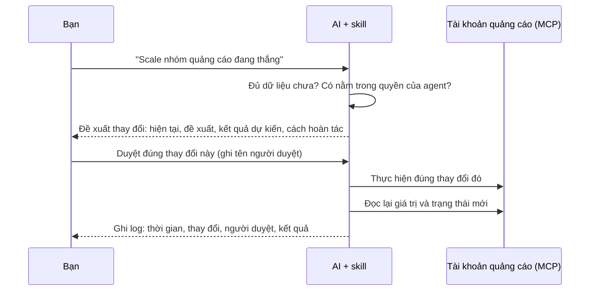

- **Quyết định ads theo một thang duy nhất.** Chi tiêu dưới 3 lần CPA mục tiêu thì chưa đủ dữ liệu để kết luận. Việc pause chỉ được đề xuất, không bao giờ tự làm. Ngân sách tăng +20-30% mỗi bước, cách nhau ít nhất 72 giờ.
- **Câu hỏi pháp lý Việt Nam** đi về một hub: [`phap-ly-marketing-vn.md`](skills/vi/references/phap-ly-marketing-vn.md).
- **Evals:** skill nào thay đổi hành vi đều có `evals/evals.json` (kích hoạt, định tuyến, rào chắn, context). Xem [docs/evals.md](docs/evals.md).
- **Kết nối nền tảng quảng cáo (MCP):** skill 03, 07, 08, 10, 13, 21, 39 và 51-57 đọc được dữ liệu ads trực tiếp. Cách cài: [docs/mcp-setup-guide.md](docs/mcp-setup-guide.md).

---

## 🔌 Dùng với AI tool khác

Skill là Markdown thuần với phần header ngắn, nên trợ lý nào đọc được file là dùng được.

| Tool | Cách dùng |
|---|---|
| **Claude Code** | Plugin, hoặc `install.sh --global` / `--project` |
| **Claude.ai Projects** | Tải các skill cần dùng và thư mục `knowledge/` lên làm project knowledge |
| **ChatGPT** | Đưa skill vào phần instructions hoặc knowledge file của một Custom GPT |
| **Gemini** | Dán skill vào một Gem hoặc system prompt |
| **Cursor, Windsurf** | Thêm các skill hay dùng vào project rules |
| **GitHub Copilot** | Trỏ tới skill từ `.github/copilot-instructions.md` |
| **Cline** | Liệt kê đường dẫn skill và từ khoá kích hoạt trong `.clinerules` |
| **Aider** | `aider --read path/to/SKILL.md` |
| **Codex CLI, OpenCode và agent khác** | Trỏ agent tới các thư mục `SKILL.md` đã cài, hoặc nhắc tới chúng trong `AGENTS.md` |
| **Bất kỳ khung chat nào** | Dán một `SKILL.md`, rồi viết: "Làm theo workflow này. Input của tôi: …" |

<details>
<summary><b>Ví dụ: <code>.clinerules</code> cho Cline</b></summary>

```markdown
# Load ai-business-skills for marketing tasks
Skills live in:
- ~/.claude/skills/marketing/vi/   (Vietnam)
- ~/.claude/skills/marketing/en/   (Global)

Trigger words:
- "marketing plan" / "lập kế hoạch marketing" -> 00-marketing-plan-global / 00-ke-hoach-mkt
- "ad copy" / "viết copy" -> 05-ad-copy-global / 05-copy-quang-cao
- "design image" / "thiết kế ảnh" -> 30-design-master-global / 30-thiet-ke-master

Always read product-marketing-context first.
```

</details>

<details>
<summary><b>Dùng thủ công trong khung chat bất kỳ, từng bước</b></summary>

1. Dán `skills/vi/product-marketing-context/SKILL.md` (hoặc bản Global) và trả lời các câu hỏi. Giữ lại câu trả lời.
2. Mở skill cần dùng, ví dụ `skills/vi/00-ke-hoach-mkt/SKILL.md`.
3. Dán skill đó cùng context đã lưu, rồi viết: "Làm theo workflow này. Input của tôi: …"
4. AI sẽ làm theo câu hỏi, quy tắc và mẫu kết quả của skill.

</details>

---

## 🧱 Bên trong một skill

<details>
<summary><b>Một file <code>SKILL.md</code> gồm những gì</b></summary>

```markdown
---
name: 00-ke-hoach-mkt
description: Mô tả ngắn, AI dùng để quyết định khi nào chạy skill
category: strategy
triggers:
  - "lập kế hoạch marketing"
  - "marketing plan"
output: file .md gồm 7 phần + KPI theo 3 kịch bản
related: [08-nghien-cuu-doi-thu, 09-insight-khach-hang, 10-tinh-kpi-nguoc]
---

# Tên skill

## Thu thập thông tin   -> tối đa 4 câu hỏi, bỏ qua câu nào context đã trả lời
## Nguyên tắc          -> insight trước số liệu, benchmark địa phương, không nói chung chung
## Cấu trúc kết quả    -> đúng các phần, bảng và kịch bản phải giao
## Checklist chất lượng -> kiểm tra trước khi giao file
```

</details>

---

## 📊 Benchmark Việt Nam 2025-2026 (tra nhanh)

| Chỉ số | Kém | Trung bình | Tốt | Xuất sắc |
|---|---|---|---|---|
| **CPMess Meta** | >40K | 25-40K | 18-25K | <18K |
| **CPMess TikTok** | >45K | 28-45K | 20-28K | <20K |
| **Lead → Booking** | <40% | 40-60% | 60-75% | >75% |
| **Booking → Khách hàng** | <25% | 25-40% | 40-55% | >55% |
| **ROAS** | <2x | 2-4x | 4-7x | >7x |
| **Email open rate** | <15% | 15-25% | 25-35% | >35% |
| **Zalo OA read rate** | <40% | 40-60% | 60-80% | >80% |

Chi phí tính bằng VND. Theo ngành: [`references/benchmarks-vietnam.md`](references/benchmarks-vietnam.md) · Global: [`references/benchmarks-global.md`](references/benchmarks-global.md)

---

## 📚 Hướng dẫn

| Hướng dẫn | Dành cho |
|---|---|
| [Bắt đầu (VN)](docs/getting-started.md) · [Global](docs/getting-started-global.md) | Giờ đầu tiên |
| [Thương hiệu cá nhân](docs/getting-started-personal-brand.md) | Founder, coach, creator |
| [Role SOP pack](docs/getting-started-role-sop.md) | Đội content, thiết kế, performance và leader |
| [Hướng dẫn workflow](docs/workflow-guide.md) · [Bản đồ skill](docs/skill-map.md) | Nối các skill với nhau |
| [Khu vực Global](docs/global-region-guide.md) · [Dropshipping](docs/dropshipping-guide.md) | Bán ra ngoài Việt Nam |
| [Cài MCP](docs/mcp-setup-guide.md) · [Connectors](CONNECTORS.md) | Dữ liệu trực tiếp từ nền tảng quảng cáo |
| [Kho kiến thức](knowledge/README.md) | Tài liệu nền theo vai trò |
| [FAQ](docs/faq.md) · [Best practices](docs/best-practices.md) · [Cập nhật](docs/update-guide.md) | Mọi thứ còn lại |

<details>
<summary><b>Cấu trúc thư mục</b></summary>

```text
ai-business-skills/
├── skills/
│   ├── vi/            Skill VN: foundation, 00-21, 29-72, 74-77, references/
│   └── en/            Skill Global: foundation, 00-21, 30-67, references/
├── modules/
│   ├── personal-branding/   22-28 trong vi/ và en/, kèm 6 workflow
│   └── dropshipping/        29-dropshipping-mastery-global, kèm 1 workflow
├── agents/            6 agent theo vai trò
├── workflows/         vi/ (8) và en/ (4)
├── knowledge/         10 file nền + trien-khai/ (14 playbook theo vai trò)
├── references/        benchmark, công thức KPI, template dùng chung
├── examples/          kết quả mẫu: spa, thời trang, coach, cửa hàng dropshipping
├── docs/              hướng dẫn, FAQ, evals, hình ảnh
├── scripts/           check-repo.mjs (kiểm tra tính nhất quán của repo)
├── install.sh · install.ps1
└── validate-skills.sh · validate-skills.ps1
```

</details>

---

## 🤝 Đóng góp

Đọc [`CONTRIBUTING.md`](CONTRIBUTING.md) trước.

```bash
git checkout -b feature/new-skill
./validate-skills.sh             # frontmatter và cấu trúc
node scripts/check-repo.mjs      # evals, denylist, llms.txt, manifest, phiên bản, số đếm
git commit -m "feat(skill): add new-skill"
```

Ưu tiên song ngữ VN + EN, một ngôn ngữ vẫn được nhận. Skill mới cần đăng ký trong `.claude-plugin/marketplace.json`.

## 💖 Ủng hộ

Dự án miễn phí, giấy phép MIT. Nếu nó giúp bạn tiết kiệm nhiều giờ làm việc, bạn có thể ủng hộ để có thêm biến thể khu vực, skill theo ngành và video hướng dẫn song ngữ tại [**opa.business/donate**](https://www.opa.business/donate). Bấm sao cho repo, [báo lỗi](https://github.com/minhnv0807/ai-business-skills/issues) và gửi PR cũng là ủng hộ.

<a href="https://star-history.com/#minhnv0807/ai-business-skills&Date">
 <picture>
   <source media="(prefers-color-scheme: dark)" srcset="https://api.star-history.com/svg?repos=minhnv0807/ai-business-skills&type=Date&theme=dark" />
   <source media="(prefers-color-scheme: light)" srcset="https://api.star-history.com/svg?repos=minhnv0807/ai-business-skills&type=Date" />
   
 </picture>
</a>

## 📜 Giấy phép và ghi nguồn

MIT, xem [LICENSE](LICENSE). Nguồn ý tưởng bên thứ ba và giấy phép của chúng: [NOTICE.md](NOTICE.md).
Lấy cảm hứng từ [coreyhaines31/marketingskills](https://github.com/coreyhaines31/marketingskills) (ý tưởng foundation skill và cấu trúc plugin). Tuân theo [Agent Skills spec](https://agentskills.io).
Hình minh hoạ do AI tạo (mô hình ảnh của Google qua Antigravity); prompt và ghi chú nằm trong [docs/images/README.md](docs/images/README.md).

<p align="center">
  <sub>Framework của <a href="https://opa.business">Over Powers Agency</a> · Làm bằng AI, cho người làm marketing dùng AI.</sub>
</p>
