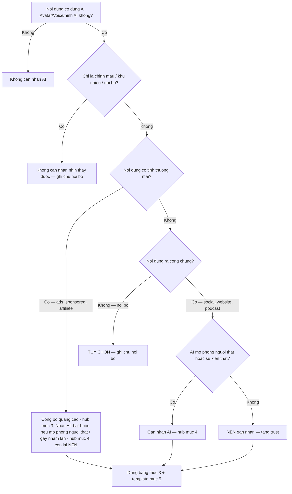

# AI Video Disclosure VN — Cach Gan Nhan Khi Dung AI Avatar / Voice

> **Reference file** — Load khi dung `24-ai-avatar-production`, `25-voice-clone-podcast`, `04-script-video` (Personal Brand Mode), `76-van-hanh-san-tmdt` (livestream co AI host).
> **Cap nhat:** 2026-10 · Thi truong: Viet Nam.
> **KHONG PHAI TU VAN PHAP LY.** Cau hoi rui ro cao -> hoi luat su.
> File nay la **how-to gan nhan thuc te**. Noi dung luat nam o `skills/vi/references/phap-ly-marketing-vn.md` — khong chep lai o day.

---

## 1. Can Cu Phap Ly (tom tat)

- **Luat Tri tue nhan tao 134/2025/QH15, Dieu 11** (hieu luc 2026-03-01): minh bach — nguoi dung phai biet dang tuong tac voi AI; am thanh / hinh anh / video do AI tao hoac chinh sua mo phong nguoi that hoac tai hien su kien that phai co dau hieu nhan biet.
- **ND 142/2026/ND-CP, Dieu 18** (hieu luc 2026-05-01): thong bao va nhan nhin thay duoc tren noi dung AI da ra cong chung **ma co the gay nham lan** ve tinh xac thuc cua su kien, con nguoi hoac nguon goc. Ngoai le: chinh sua ky thuat chi nang chat luong am thanh / hinh anh; noi dung chi dung noi bo.
- **KOL/KOC va quang cao** (cong bo "quang cao" truoc va trong khi quang cao): xem hub muc 3 — day la nghia vu **rieng**, khong thay the nhan AI.
- Chi tiet va cap nhat: `skills/vi/references/phap-ly-marketing-vn.md` **muc 4**. Kiem tra van ban goc tai vbpl.vn / thuvienphapluat.vn.

> Tach ro: muc 1 la **nghia vu phap ly** (theo hub). Tu muc 2 tro di la **thuc hanh tot** — khuyen nghi van hanh, khong phai trich luat.

---

## 2. Quy Tac 3 Tang Disclose (thuc hanh tot)

| Tang | Khi nao | Vi du | Ghi chu |
|------|---------|-------|---------|
| **BAT BUOC gan nhan AI** (nghia vu phap ly) | AI mo phong nguoi that / tai hien su kien that, hoac co the gay nham lan, va ra cong chung; chatbot tra loi khach (nguoi dung phai biet dang noi voi AI) | Avatar / clone giong nguoi that dung trong ads, review, chatbot Zalo OA | Can cu: hub muc 4 |
| **BAT BUOC cong bo quang cao** (nghia vu rieng, khong phai nhan AI) | Quang cao, sponsored, affiliate — dung AI hay khong | Dong "quang cao" / "hop tac voi [brand]" | Can cu: hub muc 3 |
| **NEN** (thuc hanh tot / chinh sach nen tang) | Noi dung AI khac khong thuoc 2 dong tren: personal brand, anh minh hoa, ads dung hinh AI khong mo phong nguoi that | Bai chia se kien thuc, podcast, video giao duc | Khong phai nghia vu luat, nhung giu trust — nen lam |
| **TUY CHON** | Test noi bo, draft chua publish, group kin noi bo | A/B test creative, internal review | Ngoai le "chi dung noi bo" cua hub; van nen ghi chu noi bo |

- Vi tri: noi nguoi xem thay **truoc khi tuong tac** (tu giay dau, dong dau caption). Khong an, khong de chung trong dong hashtag.
- Ngon ngu: tieng Viet ro rang, dung tu "AI" hoac "tao bang AI".
- Disclosure la loi the canh tranh (minh bach), khong phai bat loi. Khong co so lieu thi truong thi dung `[CAN SO LIEU THAT]`, khong tu nghi ra phan tram.

---

## 3. Bang Nhan Theo Dinh Dang (thuc hanh tot)

| Dinh dang | Nhan o dau | Khi nao (tu lan tiep xuc dau tien) | Cau mau |
|-----------|------------|------------------------------------|---------|
| **Video** (co hinh AI / clone) | Text tren man hinh + dong dau caption | Tu giay dau, giu du lau de doc het | "Video nay co hinh anh/giong noi tao bang AI" |
| **Anh tinh** (AI tao) | Goc anh hoac dong dau caption | Ngay khi anh hien thi, nhat la khi co the tuong la anh that | "Anh minh hoa tao bang AI" |
| **Giong AI / audio** (podcast, voice-over) | Cau noi o dau file + mo ta tap | Cau dau tien truoc noi dung chinh | "Giong doc trong tap nay do AI tao, kich ban cua [Ten ban]" |
| **AI avatar / digital human** | Badge co dinh tren khung hinh suot video | Tu giay dau den het | Badge "AI Avatar" hoac "Nhan vat AI" |
| **AI host livestream** | Badge co dinh + loi noi dau phien + nhac lai giua phien | Truoc khi host bat dau ban hang | "Ban dang xem host AI. Chu tai khoan: [Ten]" (kem cong truoc live: hub muc 5) |
| **Chatbot / tro ly AI** | Tin nhan mo dau + ten hien thi | Truoc cau tra loi dau tien | "Ban dang chat voi tro ly AI. Can gap nhan vien, go 'nhan vien'" |

> Chinh mau, khu nhieu, nang chat luong khong can nhan (ngoai le ky thuat, hub muc 4). Dau hieu may doc (metadata, C2PA) la them, khong thay nhan nhin thay duoc.

---

## 4. Nhan Cua Nen Tang

Moi muc duoi day la **chinh sach nen tang** — kiem tra Help Center [2026-10]; ten nut va vi tri co the doi.

| Nen tang | Cong cu nhan | Nguon |
|----------|--------------|-------|
| TikTok | Nhan "AI-generated" (bat khi dang) | chinh sach nen tang — kiem tra Help Center [2026-10] |
| Meta (Facebook / Instagram) | "AI info" | chinh sach nen tang — kiem tra Help Center [2026-10] |
| YouTube | Khai bao noi dung bi thay doi / tong hop (altered or synthetic content) trong YouTube Studio | chinh sach nen tang — kiem tra Help Center [2026-10] |

Nhan nen tang **bo sung**, khong thay nhan tren man hinh / caption cua ban.

---

## 5. Template Disclosure Cho Tung Nen Tang

### TikTok

**Bio line:**
```
Mot so video co AI Avatar | Noi dung do [Ten ban] bien soan
```

**Text overlay (3 giay dau):**
```
Video nay co hinh anh/giong noi tao bang AI
```

### YouTube

**Description (dong dau):**
```
Luu y: Video nay duoc tao voi ho tro AI Avatar.
Hinh anh va giong noi dua tren [Ten ban] (da dong y).
Noi dung do [Ten ban] bien soan va duyet.
```

**End screen (5 giay cuoi):** `Video dung AI Avatar — Noi dung boi [Ten ban]`

### Facebook / Instagram

**Post text (dau hoac cuoi bai):**
```
Noi dung nay tao voi ho tro AI Avatar. Giong noi va hinh anh dua tren toi (nguoi that), noi dung do toi bien soan.
```

**Ads:** dat dong gan nhan trong primary text va tren video. Dong cong bo "quang cao" van phai co (hub muc 3).
```
Quang cao nay dung AI de tao hinh anh/giong noi. Thong tin phan anh san pham/dich vu thuc cua [Ten thuong hieu].
```

### LinkedIn

```
*Luu y: Video nay dung AI Avatar de toi uu san xuat. Noi dung va quan diem la cua toi.*
```

### Website ca nhan

**Footer:** `Mot so noi dung tren website dung AI Avatar va AI Voice. Noi dung do [Ten ban] duyet truoc khi dang.`

**Trang About:** mot doan rieng noi ro AI chi ho tro phan hinh anh/giong noi; bien soan va quan diem la cua ban.

---

## 6. Khi Nao KHONG Dung AI Avatar

Day la **rui ro / thuc hanh tot**, khong phai danh sach dieu luat. Hau qua cu the (muc phat, truy cuu) — hoi luat su.

1. **Gia danh nguoi khac** (avatar / voice clone giong nguoi noi tieng, doi tac, nhan su cu) khi chua co **van ban dong y** nguoi do. Rui ro: tranh chap hinh anh / giong noi, bi go noi dung, mat uy tin.
2. **Tin gia / deepfake chinh tri hoac nguoi that**: khong lam. Day la noi dung luat AI nham vao.
3. **Testimonial gia**: avatar dong vai "khach hang" review san pham. Xem hub muc 3 (nguoi chuyen tai khong duoc quang cao san pham chua dung) va muc 7 (lan ranh do).
4. **Y te / tai chinh** khong co disclaimer va khong co nguoi co chuyen mon chiu trach nhiem. Doi chieu `74-copy-hai-lop/references/bien-gioi-va-nguon.md` muc "Luat va rui ro VN".
5. **Clone giong / mat that** cua nguoi khac khi chua co hop dong ro pham vi, thoi han, quyen rut lai — xem `25-voice-clone-podcast`, `75-hop-tac-koc-affiliate`.

---

## 7. Tinh Huong Minh Hoa (gia dinh, khong phai du lieu that)

- **Giau AI roi bi phat hien:** creator dung avatar dang video hang ngay, khong gan nhan. Nguoi xem phat hien qua loi dong bo moi, comment nghi ngo tang. Cach go: them nhan vao bio, ghim comment giai thich, lam mot video mat that noi ro vi sao dung AI. So lieu: `[CAN SO LIEU THAT]`.
- **Clone giong khong xin phep:** creator clone giong mot KOL de lam podcast. Nen tang go noi dung khi bi bao cao. Bai hoc: khong clone khi chua co van ban dong y.
- **Hybrid minh bach:** founder ket hop video mat that (live, Q&A, hau truong) voi video avatar ngan (tip, recap), luon gan nhan ro. Bai hoc: tron that + AI duoc, mien la khach biet dau la dau.

---

## 8. Decision Tree: "Toi Co Can Gan Nhan Khong?"



---

## 9. Disclosure Copy Template — 5 Mau San Dung

### Mau 1 — Ngan (Story, Reels, TikTok overlay)
```
Video su dung cong nghe AI Avatar
```

### Mau 2 — Trung (Post caption, description)
```
Noi dung nay duoc tao voi ho tro AI. Giong noi va hinh anh dua tren [Ten ban] thuc te.
```

### Mau 3 — Dai (Quang cao thuong mai)
```
THONG BAO: Video quang cao nay dung AI Avatar va AI Voice de tao hinh anh va giong noi.
Noi dung phan anh san pham/dich vu thuc te cua [Ten thuong hieu]. Thong tin trong video
da duoc [Ten ban] kiem duyet va xac nhan.
```

### Mau 4 — Tieng Anh (khan gia quoc te)
```
This content was created with AI avatar technology. Voice and likeness are based on
a real person. All content is reviewed and approved by the creator.
```

### Mau 5 — Song ngu VN + EN
```
Video su dung cong nghe AI | Noi dung chinh chu boi [Ten ban]
This video uses AI technology | Authentic content by [Your name]
```

---

## 10. Checklist Truoc Khi Dang

- [ ] Nhan AI nhin thay duoc tu giay dau (video) hoac dong dau (caption).
- [ ] Avatar / livestream co badge co dinh; chatbot co tin nhan mo dau.
- [ ] Neu la quang cao / hop tac: dong cong bo "quang cao" rieng (hub muc 3).
- [ ] Da bat nhan cua nen tang (muc 4) va kiem tra Help Center [2026-10].
- [ ] Giong / mat that cua nguoi khac: co van ban dong y.
- [ ] Khong co testimonial gia, khong co claim thieu bang chung.
